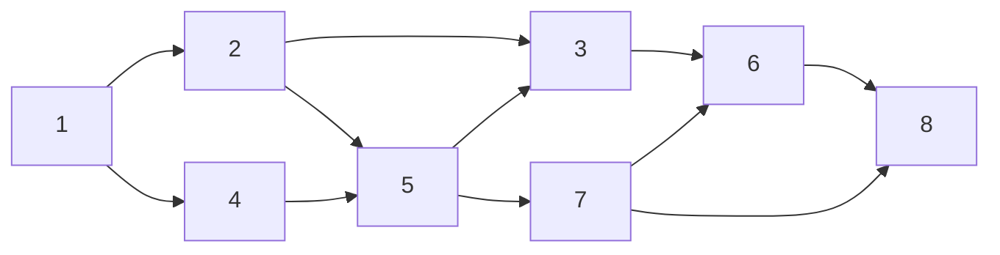
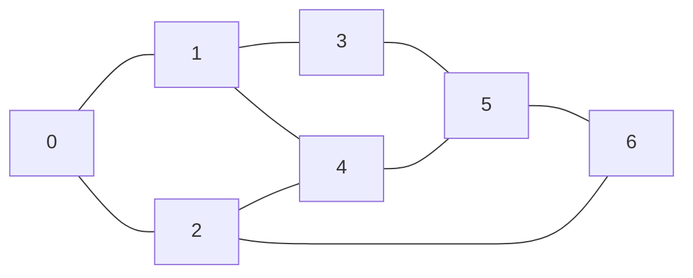

# 13a — Graphs 1 · Final MCQ Practice

> [!info] Conventions (from the slides)
> Neighbours are processed in **increasing (numerical/alphabetical) order**. BFS uses a queue and marks a vertex when it is enqueued. Preorder DFS lists vertices by start time, postorder DFS by finish time. Topological sort repeatedly removes a vertex of in-degree $0$.

**Graph $G_1$ (directed)**, edges: $1\to2,\ 1\to4,\ 2\to3,\ 2\to5,\ 3\to6,\ 4\to5,\ 5\to3,\ 5\to7,\ 6\to8,\ 7\to6,\ 7\to8$

**Graph $G_2$ (undirected)**, edges: $0\!-\!1,\ 0\!-\!2,\ 1\!-\!3,\ 1\!-\!4,\ 2\!-\!4,\ 2\!-\!6,\ 3\!-\!5,\ 4\!-\!5,\ 5\!-\!6$

---

**1.** The breadth-first traversal of $G_1$ starting from vertex $1$ is:

- (A) $1,2,3,6,8,5,7,4$
- (B) $1,2,4,3,5,6,7,8$
- (C) $1,2,4,5,3,7,6,8$
- (D) $1,4,2,5,3,7,6,8$
- (E) $1,2,4,3,5,7,6,8$

> [!check]- Answer
> **(B)**. Dequeue $1$ and enqueue $2,4$. Dequeue $2$ and enqueue $3,5$. Dequeue $4$ ($5$ is already marked). Dequeue $3$ and enqueue $6$. Dequeue $5$ and enqueue $7$. Dequeue $6$ and enqueue $8$. Then $7$ and $8$.

**2.** The **preorder** depth-first traversal of $G_1$ starting from vertex $1$ is:

- (A) $1,2,3,6,8,5,7,4$
- (B) $1,2,4,3,5,6,7,8$
- (C) $1,2,5,3,6,8,7,4$
- (D) $8,6,3,7,5,2,4,1$
- (E) $1,2,3,6,8,7,5,4$

> [!check]- Answer
> **(A)**. The DFS path goes $1\to2\to3\to6\to8$. Backtracking to $2$ leads to $5$; $5$'s neighbour $3$ is visited, so it goes to $7$ ($6$ and $8$ are visited). Finally back at $1$, it visits $4$.

**3.** The **postorder** depth-first traversal of $G_1$ starting from vertex $1$ is:

- (A) $8,6,3,5,7,2,4,1$
- (B) $8,6,3,7,5,2,4,1$
- (C) $4,7,5,8,6,3,2,1$
- (D) $8,7,6,5,4,3,2,1$
- (E) $8,6,7,3,5,2,4,1$

> [!check]- Answer
> **(B)**. Finish order: $8,6,3$, then $7$ finishes before $5$, then $2$, then $4$, and $1$ last.

**4.** Which of the following is **NOT** a topological ordering of $G_1$?

- (A) $1,2,4,5,3,7,6,8$
- (B) $1,4,2,5,7,3,6,8$
- (C) $1,4,2,5,3,7,6,8$
- (D) $1,2,3,4,5,7,6,8$
- (E) $1,2,4,5,7,3,6,8$

> [!check]- Answer
> **(D)**. The edge $5\to3$ requires $5$ to come before $3$.

**5.** If the edge $8\to2$ is added to $G_1$, then:

- (A) $G_1$ still has a topological sort, starting with $1$.
- (B) the in-degree algorithm stops before visiting all vertices, so there is no topological sort.
- (C) the topological sort becomes unique.
- (D) BFS can no longer visit vertex $8$.
- (E) $G_1$ becomes strongly connected.

> [!check]- Answer
> **(B)**. The new cycle $2\to3\to6\to8\to2$ means that after $1$ and $4$ are removed, no vertex has in-degree $0$. This is how topological sort **detects a cycle** in a directed graph.

**6.** The **preorder** DFS of the undirected graph $G_2$ starting at $0$ is:

- (A) $0,1,2,3,4,6,5$
- (B) $0,1,3,5,6,2,4$
- (C) $0,1,3,5,4,2,6$
- (D) $0,2,4,1,3,5,6$
- (E) $0,1,4,2,6,5,3$

> [!check]- Answer
> **(C)**. $0\to1\to3\to5$. At $5$ the neighbours are $3$ (visited), then $4$; from $4$ go to $2$, then from $2$ go to $6$.

**7.** The breadth-first traversal of $G_2$ starting at $0$ is:

- (A) $0,1,2,3,4,5,6$
- (B) $0,1,2,3,4,6,5$
- (C) $0,1,3,5,4,2,6$
- (D) $0,2,1,4,6,3,5$
- (E) $0,1,2,4,3,6,5$

> [!check]- Answer
> **(B)**. From $1$ enqueue $3,4$; from $2$ enqueue $6$ ($4$ is already queued); $5$ is reached last, from $3$.

**8.** The space complexity of an **adjacency matrix** for a graph with $n$ vertices and $m$ edges is:

- (A) $\Theta(nm)$
- (B) $\Theta(n^2)$
- (C) $\Theta(n+m)$
- (D) $\Theta(n^2+m)$
- (E) $\Theta(m^2)$

> [!check]- Answer
> **(B)**. It is a $|V|\times|V|$ array regardless of the number of edges.

**9.** Which statement is **true**?

- (A) With an adjacency list, checking whether edge $(u,v)$ exists costs $O(1)$.
- (B) With an adjacency matrix, adding an edge costs $O(|V|)$.
- (C) An adjacency matrix uses less space than an adjacency list when $|E|\ll|V|^2$.
- (D) An adjacency list uses less space than an adjacency matrix when the graph is sparse.
- (E) None of the given statements is true.

> [!check]- Answer
> **(D)**. A list needs $O(|V|+|E|)$ space and a matrix $O(|V|^2)$. Edge lookup is $O(1)$ with a matrix but $O(|V|)$ with a list.

**10.** In an undirected graph with adjacency matrix $M$, the degree of vertex $v$ equals:

- (A) the sum of row $v$ only
- (B) the sum of column $v$ only
- (C) the sum of row $v$, which equals the sum of column $v$
- (D) the sum of the whole matrix
- (E) the diagonal entry $M[v][v]$

> [!check]- Answer
> **(C)**. The matrix is symmetric. For a **directed** graph, the row sum is the out-degree and the column sum is the in-degree.

**11.** In the adjacency-list representation of an undirected graph with $|E|$ edges, the total number of list nodes is:

- (A) $|E|$
- (B) $2|E|$
- (C) $|V|+|E|$
- (D) $|V|^2$
- (E) $|E|/2$

> [!check]- Answer
> **(B)**. Each edge $(i,j)$ appears in both $i$'s list and $j$'s list.

**12.** Using **adjacency lists**, finding all **predecessors** (incoming neighbours) of a vertex in a directed graph costs:

- (A) $O(1)$
- (B) $O(|V|)$
- (C) $O(|E|+|V|)$
- (D) $O(|V|^2)$
- (E) $O(\log|V|)$

> [!check]- Answer
> **(C)**. You must traverse **all** lists. With a matrix you scan one column, which is $O(|V|)$.

**13.** BFS and DFS on a graph cost:

- (A) $O(|V|+|E|)$ with lists and $O(|V|^2)$ with a matrix
- (B) $O(|V|^2)$ with both
- (C) $O(|E|\log|V|)$ with lists
- (D) $O(|V|)$ with a matrix
- (E) $O(|V|\cdot|E|)$ with lists

> [!check]- Answer
> **(A)**. With a matrix, finding the neighbours of each vertex costs a full row scan of $O(|V|)$.

**14.** In a simple undirected graph with $|V|$ vertices, the maximum number of vertices adjacent to one vertex, and the maximum number of edges, are:

- (A) $|V|$ and $|V|^2$
- (B) $|V|-1$ and $\frac{|V|(|V|-1)}{2}$
- (C) $|V|-1$ and $|V|(|V|-1)$
- (D) $|V|$ and $\frac{|V|(|V|-1)}{2}$
- (E) $\frac{|V|}{2}$ and $|V|-1$

> [!check]- Answer
> **(B)**. There are no loops or multi-edges, so a vertex has at most $|V|-1$ neighbours. The edge count is $\binom{|V|}{2}$.

**15.** A directed graph has **no** topological sort if:

- (A) the in-degree of every vertex is greater than zero.
- (B) it has a vertex of out-degree zero.
- (C) it is weakly connected.
- (D) it has more edges than vertices.
- (E) it is not strongly connected.

> [!check]- Answer
> **(A)**. The algorithm cannot even start without a vertex of in-degree $0$, which means there is a cycle.

**16.** Which kind of DAG has a **unique** topological sort?

- (A) Any DAG with a single source
- (B) A DAG that contains a directed path through all of its vertices
- (C) Any DAG with $|E|=|V|-1$
- (D) A DAG with no edges
- (E) Every DAG

> [!check]- Answer
> **(B)**. With a Hamiltonian path, at each step exactly one vertex has in-degree $0$. A DAG with no edges allows any order.

**17.** What is the most efficient algorithm (among these) to find a shortest path between vertices $a$ and $b$ in an **unweighted** graph?

- (A) BFS starting from $a$
- (B) Postorder DFS starting from $a$
- (C) Preorder DFS starting from $a$
- (D) Topological sort
- (E) Kruskal's algorithm

> [!check]- Answer
> **(A)**. BFS reaches vertices in increasing number of edges from $a$, in $O(|V|+|E|)$. Dijkstra also works but is unnecessary overhead.
