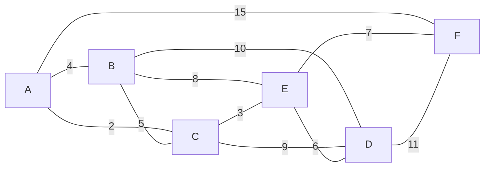

# 13b — Graphs 2 · Final MCQ Practice

> [!info] Conventions (from the slides)
> Dijkstra and Prim repeatedly pick the **unvisited vertex with the smallest cost**. Dijkstra updates with $d(v)=\min(d(u)+w(u,v),\,d(v))$; Prim updates with $d(v)=\min(w(u,v),\,d(v))$. Kruskal sorts the edges in increasing weight and adds an edge if it creates no cycle. Strongly connected means there is a path between every ordered pair. **Weakly connected** (as defined in the slides) means the underlying undirected graph is connected **and** some pair is not mutually reachable.

**Graph $G_3$ (undirected, weighted)**

| Edge | AC | CE | AB | BC | ED | EF | BE | CD | BD | DF | AF |
|---|---|---|---|---|---|---|---|---|---|---|---|
| Weight | 2 | 3 | 4 | 5 | 6 | 7 | 8 | 9 | 10 | 11 | 15 |

**Graph $G_4$ (directed)**, edges: $1\to2,\ 2\to3,\ 3\to4,\ 4\to1,\ 4\to5,\ 5\to6,\ 6\to5,\ 6\to7,\ 3\to8,\ 8\to7$

---

**1.** Running Dijkstra's algorithm on $G_3$ from $A$, in what order are the vertices marked **known** (visited)?

- (A) $A, C, E, B, D, F$
- (B) $A, C, B, E, D, F$
- (C) $A, B, C, E, D, F$
- (D) $A, C, B, E, F, D$
- (E) $A, C, E, D, B, F$

> [!check]- Answer
> **(B)**. The final distances are $C=2$, $B=4$, $E=5$, $D=11$, $F=12$, and vertices become known in increasing distance.

**2.** In Q1, the shortest distances from $A$ to $D$ and to $F$ are:

- (A) $10$ and $15$
- (B) $11$ and $15$
- (C) $11$ and $12$
- (D) $14$ and $12$
- (E) $9$ and $12$

> [!check]- Answer
> **(C)**. $d(D)=\min(A\!C\!D=2+9,\ A\!C\!E\!D=2+3+6,\ A\!B\!D=4+10)=11$. $d(F)=A\!C\!E\!F=2+3+7=12$, which beats the direct edge $15$.

**3.** Running Dijkstra on $G_3$ from $F$, the final distance to $A$ and its predecessor are:

- (A) $15$, predecessor $F$
- (B) $12$, predecessor $C$
- (C) $12$, predecessor $E$
- (D) $10$, predecessor $C$
- (E) $13$, predecessor $B$

> [!check]- Answer
> **(B)**. $A$ starts at $15$ through the direct edge. When $C$ becomes known with $d(C)=7+3=10$, $A$ improves to $10+2=12$ with predecessor $C$. The direct edge is not the shortest.

**4.** The edges of $G_3$ added by **Kruskal's** algorithm, in order, are:

- (A) $AC, CE, AB, BC, ED$
- (B) $AC, CE, AB, ED, EF$
- (C) $AC, AB, CE, ED, EF$
- (D) $AC, CE, ED, EF, AB$
- (E) $AC, CE, AB, ED, BE$

> [!check]- Answer
> **(B)**. $BC$ (weight 5) is **rejected** because $A,B,C$ are already connected. The process stops after $|V|-1=5$ edges.

**5.** The total weight of the minimum spanning tree of $G_3$ is:

- (A) $20$
- (B) $22$
- (C) $27$
- (D) $25$
- (E) $35$

> [!check]- Answer
> **(B)**. $2+3+4+6+7=22$.

**6.** Running **Prim's** algorithm on $G_3$ starting from $D$, the order in which vertices are added to the tree is:

- (A) $D, E, C, A, B, F$
- (B) $D, C, A, E, B, F$
- (C) $D, E, F, C, A, B$
- (D) $D, B, A, C, E, F$
- (E) $D, E, C, B, A, F$

> [!check]- Answer
> **(A)**. From $D$ the cheapest edge is $DE=6$. From $\{D,E\}$ it is $EC=3$, then $CA=2$, then $AB=4$, then $EF=7$. Each step adds the cheapest edge leaving the tree.

**7.** What is the primary data structure used in Dijkstra's algorithm to efficiently find the vertex with the minimum distance?

- (A) A stack
- (B) A priority queue (min-heap)
- (C) A FIFO queue
- (D) A hash table
- (E) A B-tree

> [!check]- Answer
> **(B)**. With a binary heap the cost is $O((|E|+|V|)\log|V|)$. With a plain array scan it is $O(|V|^2)$.

**8.** Which statement about Dijkstra's algorithm is **true**?

- (A) It works for graphs with negative-weight cycles.
- (B) It is guaranteed correct only for non-negative edge weights.
- (C) It works only on undirected graphs.
- (D) It computes shortest paths between every pair of vertices.
- (E) It is not a greedy algorithm.

> [!check]- Answer
> **(B)**. A negative edge "hidden behind" a large one can fool it. Bellman–Ford handles negative edges.

**9.** Which statement about Prim's and Kruskal's algorithms is **true**?

- (A) Both may produce a spanning tree containing a cycle.
- (B) Prim's selects edges in globally increasing order of weight.
- (C) The tree Prim's algorithm grows always remains connected.
- (D) They always generate the same MST.
- (E) Kruskal's may produce a non-minimal spanning tree.

> [!check]- Answer
> **(C)**. Kruskal's forest is usually disconnected until the end. With equal weights the two algorithms can produce **different** MSTs, though of the same total weight.

**10.** Which statement is **false**?

- (A) Kruskal's algorithm starts by sorting the edges in increasing order of weight.
- (B) Kruskal's adds an edge only if it does not create a cycle.
- (C) Kruskal's always produces an MST of smaller total weight than Prim's.
- (D) Prim's works best on dense graphs and Kruskal's on sparse graphs.
- (E) Kruskal's with sorting or a min-heap costs $O(|E|\log|E|)$.

> [!check]- Answer
> **(C)**. Both produce **minimum** spanning trees, so their total weights are equal.

**11.** For any two spanning trees of the same connected, weighted, undirected graph, which is **always** true?

- (A) They have the same edges.
- (B) They have the same total weight.
- (C) They have the same number of edges.
- (D) They have the same number of edges and the same total weight.
- (E) They have the same root.

> [!check]- Answer
> **(C)**. Every spanning tree has exactly $|V|-1$ edges. Only **minimum** spanning trees must share the total weight.

**12.** A connected undirected graph with $n$ vertices must have **at least** how many edges?

- (A) $n$
- (B) $n-1$
- (C) $n/2$
- (D) $2n$
- (E) $\frac{n(n-1)}{2}$

> [!check]- Answer
> **(B)**. That minimum is achieved by a tree.

**13.** How many strongly connected components does $G_4$ have, and what is the size of the largest?

- (A) $3$ components, largest size $4$
- (B) $4$ components, largest size $4$
- (C) $4$ components, largest size $3$
- (D) $2$ components, largest size $6$
- (E) $5$ components, largest size $2$

> [!check]- Answer
> **(B)**. The components are $\{1,2,3,4\}$ (cycle $1\to2\to3\to4\to1$), $\{5,6\}$, $\{7\}$ and $\{8\}$. Nothing returns from $7$ or $8$.

**14.** To test whether a directed graph with $n$ vertices and $m$ edges is strongly connected, method (1) runs a traversal from **every** vertex, and method (2) counts SCCs with Kosaraju's two-pass DFS. Their time complexities are:

- (A) (1) $\Theta(n^2+nm)$, (2) $\Theta(n+m)$
- (B) (1) $\Theta(n+m)$, (2) $\Theta(n+m)$
- (C) (1) $\Theta(n^2+nm)$, (2) $\Theta(n^2+nm)$
- (D) (1) $\Theta(nm)$, (2) $\Theta(n\log n)$
- (E) (1) $\Theta(n^2)$, (2) $\Theta(m\log n)$

> [!check]- Answer
> **(A)**. Method (1) is $|V|$ traversals of $O(|V|+|E|)$ each. Kosaraju is two DFS passes plus a transpose.

**15.** Using the slides' definitions, which statement is **false**?

- (A) A weakly connected graph has at least two strongly connected components.
- (B) A strongly connected graph has a directed path between any two distinct vertices.
- (C) A connected undirected graph has exactly one connected component.
- (D) A directed graph can be neither strongly nor weakly connected.
- (E) A weakly connected graph always has exactly one strongly connected component.

> [!check]- Answer
> **(E)**. Weakly connected (slides) means some pair is not mutually reachable, so there must be $\ge 2$ SCCs. Statement (D) is true for a directed graph whose underlying undirected graph is disconnected.

**16.** To detect a cycle in an **undirected** graph with DFS, the algorithm must track:

- (A) the predecessor of each vertex.
- (B) the in-degree of each vertex.
- (C) the number of edges traversed so far.
- (D) the finish time of each vertex.
- (E) the weight of each edge.

> [!check]- Answer
> **(A)**. A cycle exists when DFS meets an already-visited neighbour that is **not** the current vertex's predecessor.

**17.** Which algorithm can be used to detect a cycle in a **directed** graph?

- (A) Kruskal's algorithm
- (B) Prim's algorithm
- (C) Topological sort
- (D) Dijkstra's algorithm
- (E) Breadth-first traversal alone

> [!check]- Answer
> **(C)**. If the in-degree-$0$ removal stops before every vertex is visited, there is a cycle. This takes $O(|V|+|E|)$.

**18.** Which statement best describes a **greedy** algorithm?

- (A) It tries every possible solution and keeps the best.
- (B) At each phase it makes the choice that looks best now, never undoes it, and always guarantees the global optimum.
- (C) At each phase it makes the locally best choice and never undoes it; for problems like MST and shortest paths (non-negative weights), this yields the optimum.
- (D) It always uses recursion and backtracking.
- (E) It is used only for sorting.

> [!check]- Answer
> **(C)**. Greedy algorithms don't *always* give the best solution, which is why (B) is wrong. Prim, Kruskal and Dijkstra are the course's greedy examples that do.
