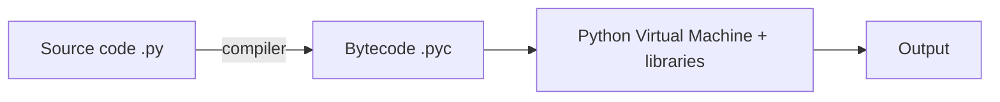
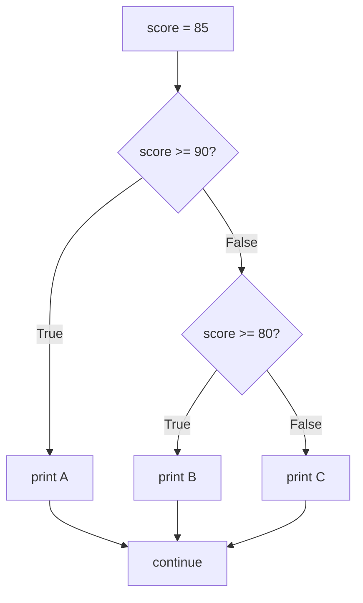
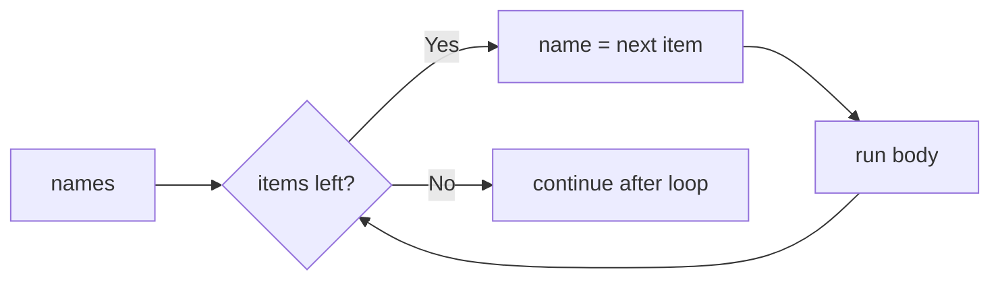
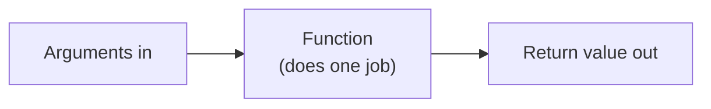

problem set: lec1,2: lec3,4: lec5,6: lec7,8:

# ==🔴Lecture 1==

## Programming Languages

- **Program** = instructions in the computer's instruction set · **Programming** = writing them
- Syntax must be exact → `print(5 + 5)`
- Abstraction levels (top → bottom): **Natural language → High-level → Low-level → Machine language** (bits: 0s & 1s)

|Feature|High-level|Low-level|
|---|---|---|
|Instruction set|Larger|Smaller|
|Writing|Easier|Harder|
|Code length|Shorter|Longer|
|Speed|Slower|Faster|

- **Python** = high-level + fast low-level libraries → best of both worlds
- **Compiler**: high/low-level code → machine language

## How a Computer Runs a Program (Chef Analogy)

|Computer|Kitchen|Role|
|---|---|---|
|CPU|Chef|Brain, executes|
|Memory (RAM)|Counter|Temporary, while processing|
|Storage|Pantry / shelves|Long-term files & programs|
|Program|Recipe|Instructions|
|Input|Ingredients||
|Output|Finished dish||

## How Python Runs



## Scripts vs Notebooks

|Feature|Script `.py`|Notebook `.ipynb`|
|---|---|---|
|Runs|Whole file, from terminal|Cell by cell, any order|
|Written in|IDE|Colab / Jupyter|
|Good for|Reusable programs, big projects|Learning, ML/AI (code + text + output)|

- Run a script: `python hello.py`
- Cell types: **Code** (runs Python) · **Markdown** (text, headings, equations, images)

> [!warning] Notebook pitfalls
> 
> - Run order matters (cell 5 before cell 2 → error if it depends on it)
> - Editing an earlier cell doesn't update later outputs
> - Stale values in memory can mess up results
> - **Fix:** restart session → run all, top to bottom

## Google Colab

- Browser-based, no install, runs on Google Cloud
- Code + text + output in one shareable notebook
- Datasets: upload or mount from Google Drive
- Free GPUs / TPUs
- Flow: browser → code to cloud runtime → executes → output back

> [!danger] Runtime is temporary
> 
> - **Lost** when runtime stops / disconnects / times out: uploaded datasets, generated files, trained model weights → **download them**
> - **Kept** (saved to Drive): notebook code, displayed outputs, markdown

## Course Path

Colab → notebooks (concepts, examples, notes) → small code for core concepts → **VS Code** for larger projects

## Quick Recall

- Python compiles to? → **bytecode `.pyc`**
- Runs the bytecode? → **PVM**
- Why is Python fast? → **low-level libraries**
- RAM? → **counter** · Storage? → **pantry** · CPU? → **chef**
- Notebook cell types? → **code & markdown**
- Lost after Colab runtime ends? → **data, files, model weights** (not the notebook)
- Weird notebook results? → **restart & run all**

Source: [Lecture 1 video](https://youtu.be/E8kMWobEoXI)

# ==🔴Lecture 2==

## Print

- `print()` = built-in function → shows output on screen
- Strings go in quotes `'...'` or `"..."` (be consistent) → quotes aren't printed
- Prints any type: `print("Python is fun")`, `print(42)`, `print(3.14)`, `print(True)`
- Multiple values → separate with commas: `print("Name:", "Aisha", "Age:", 20)`

|Argument|Default|Example|
|---|---|---|
|`sep` (between values)|space `" "`|`print("a", "b", sep="-")` → `a-b`|
|`end` (after the print)|new line `"\n"`|`print("Hello", end=" ")` → next print stays on same line|

- **Comments** start with `#` → ignored by Python, for humans

## Variables

- Variable = name that refers to a value → store now, use later
- `=` is **assignment**, not math equality → `student_name = "Aisha"`, `age = 20`
- Read a variable by its name → `print(age + 1)`
- `score = score + 5` → reads old value (90), adds 5, stores 95
- Python variables can change type (`x = 10` → `x = "ten"`) → allowed, but need a good reason

### Data Types

|Type|Meaning|Example|
|---|---|---|
|`int`|Whole number|`40`, `2026`, `-5`|
|`float`|Decimal number|`19.9`, `4.0`, `-0.05`|
|`str`|Text|`"Aisha"`|
|`bool`|True / False|`True`|
|`None`|Empty, no data (NoneType)|`None`|

- Check type → `type(3.5)` → `float`
- `7` is `int`, `7.0` is `float` → same value, different type

### Naming Rules

- Only letters, digits, `_`
- Can't start with a digit · no spaces · case-sensitive · no Python keywords
- Convention: `snake_case`, meaningful names, `ALL_CAPS` only for constants

|Name|Verdict|
|---|---|
|`final_score = 88`|✅ Good|
|`MAX_ATTEMPTS = 3`|✅ Good (constant)|
|`2score = 88`|❌ Starts with a digit|
|`student count = 30`|❌ Has a space|
|`x = 88`|⚠️ Legal but meaningless|

## Numbers & Arithmetic

|Operator|Meaning|Example|
|---|---|---|
|`+` `-` `*`|Add, subtract, multiply|`2 * 3` → `6`|
|`/`|Division (always float)|`10 / 2` → `5.0`|
|`//`|Floor division (integer part)|`130 // 60` → `2`|
|`%`|Remainder|`130 % 60` → `10`|
|`**`|Power|`2 ** 3` → `8`|

- `^` is **not** power in Python (it is in MATLAB) → use `**`
- 130 min = 2 h 10 min → $130 = 2 \times 60 + 10$

> [!warning] Number surprises
> 
> - `/` always returns a float → `10 / 2` → `5.0`
> - int + float → float → `2 + 3.0` → `5.0`

### Casting

|Code|Result|Note|
|---|---|---|
|`int(7.9)`|`7`|Cuts decimals, **no rounding** → use `round()`|
|`float(7)`|`7.0`||
|`str(100)`|`"100"`||
|`int("100")`|`100`|String must hold a whole number|
|`int("hello")`|❌ Error|Not a number|

## Strings

- Quotes: `'...'` or `"..."` (start & end the same) · `"""..."""` for multi-line
- String with `'` inside → wrap in `"` → `"She said 'hello'"`
- `"42"` is a string, not a number
- `+` joins strings (concatenation) → `"Py" + "thon"` → `"Python"`

### Methods

- Method = function attached to a value → `value.method()`

|Method|Does|
|---|---|
|`.upper()`|ALL UPPERCASE|
|`.lower()`|all lowercase|
|`.title()`|Capitalize Each Word|
|`.strip()`|Remove spaces at both ends → `" python "` → `"python"`|
|`.replace(a, b)`|Replace a with b → `"050-123-4567".replace("-", " ")`|
|`.isnumeric()`|`True` only if all digits (no `-`, no `.`)|
|`len(s)`|Number of characters (function, not method)|

- Chained methods run left → right → `raw.strip().lower()` = strip first, then lower

### Indexing

- Starts at **0** → `word = "Python"` → `word[3]` → `"h"`
- Negative counts from the end → `word[-1]` → `"n"`, `word[-2]` → `"o"`
- Index too big → **IndexError** (out of range)

### Slicing

- Format: `text[start:stop:step]` → **stop is not included**
- `word = "programming"`

|Slice|Result|
|---|---|
|`word[0:3]`|`"pro"`|
|`word[3:7]`|`"gram"`|
|`word[-4:]`|`"ming"`|
|`word[:-4]`|`"program"`|
|`word[0:8:2]`|`"porm"` (every 2nd char)|

> [!warning] Strings are immutable
> 
> - Can't change part of a string → `word[0] = "J"` → ❌ error
> - Make a new one → `"J" + word[1:]` → `"Jython"`
> - Or overwrite the whole thing → `word = "Jython"`

### f-strings

- Old way: `print("Student:", name, "scored", score)` → tedious
- f-string: `print(f"Student: {name} scored {score}")` → anything in `{}` gets evaluated
- Use f-strings wherever possible

## Comparison Operators

|Operator|Meaning|Example|
|---|---|---|
|`==`|Equal|`75 == 75` → `True`|
|`!=`|Not equal|`"Ali" != "Aisha"` → `True`|
|`<` `>`|Less / greater|`3 < 5` → `True`|
|`<=` `>=`|Less or equal / greater or equal|`5 >= 5` → `True`|

- `=` assigns, `==` compares
- Result is always a bool (`True` / `False`)

## Errors

- Errors are normal → e.g. `a / b` with `b = 0` → **ZeroDivisionError**
- Python shows a **traceback** → long, but read it from the bottom

> [!tip] Reading a traceback
> 
> 1. **Last line** → what went wrong (e.g. `ZeroDivisionError: division by zero`)
> 2. **Line above** → where it happened → go fix that line

## Quick Recall

- Default `sep`? → **space** · default `end`? → **new line**
- Comment symbol? → **`#`**
- `=` vs `==`? → **assign** vs **compare**
- `10 / 2`? → **`5.0`** · `2 + 3.0`? → **`5.0`**
- `130 // 60` · `130 % 60`? → **`2`** · **`10`**
- Power operator? → **`**`** (not `^`)
- `int(7.9)`? → **`7`** (cuts, doesn't round)
- First index? → **`0`** · last char? → **`[-1]`**
- `"programming"[0:3]`? → **`"pro"`** (stop not included)
- Change `word[0]`? → **no, strings are immutable**
- `"-5".isnumeric()`? → **`False`**
- Variable name starting with a digit? → **not allowed**
- Traceback: read which line first? → **the last line**

Source: [Lecture 2 video](https://youtu.be/7xtf7ToKJ58)

# ==🔴Lecture 3==

## Containers

- One variable = one value → **container** = many values under one name

|Container|Syntax|Ordered|Changeable|Duplicates|
|---|---|---|---|---|
|List|`[1, 2, 3]`|✅|✅|✅|
|Tuple|`(1, 2, 3)`|✅|❌|✅|
|Dict|`{"a": 1}`|by key|✅|keys unique|
|Set|`{1, 2, 3}`|❌|✅|❌|

## Lists

- `scores = [88, 92, 75]` · empty → `[]` · can mix types
- Indexing & slicing work like strings → `scores[0]` → `88`, `scores[-1]` → `75`, `scores[0:2]` → `[88, 92]`
- Lists are **mutable** → `scores[1] = 95` ✅ (strings can't do this)
- `len(scores)` → number of items

### Growing a List

|Method|Does|Example|
|---|---|---|
|`.append(x)`|Add one item at the end|`scores.append(70)`|
|`.extend([...])`|Add many items at the end|`scores.extend([60, 99])`|
|`.insert(i, x)`|Add at position `i`|`scores.insert(0, 100)`|
|`+`|Join two lists → new list|`[1, 2] + [3]` → `[1, 2, 3]`|

### Sorting

|Code|Result|
|---|---|
|`scores.sort()`|Sorts **in place** → changes `scores`, returns `None`|
|`sorted(scores)`|Returns a **new** sorted list → original unchanged|
|`reverse=True`|Descending → `sorted(scores, reverse=True)`|

> [!warning] `x = scores.sort()` → `x` is `None` Use `sorted()` when you want the result in a new variable.

### Copying

> [!danger] `b = a` is NOT a copy Both names point to the **same** list → changing `b` changes `a` too.

```python
a = [1, 2, 3]
b = a
b.append(4)
print(a)   # [1, 2, 3, 4]  ← a changed too!
```

- Real copy → `b = a.copy()` or `b = a[:]` or `b = list(a)`

## Tuples

- Like a list, but **immutable** → for **fixed records**
- `student = ("Aisha", 20, "CS")` → `student[0]` → `"Aisha"`
- `student[1] = 21` → ❌ error
- **Unpacking** → `name, age, major = student`

## Dictionaries

- **Key → value** pairs → look up by **name**, not position
- `ages = {"Aisha": 20, "Omar": 22}`

|Code|Does|
|---|---|
|`ages["Aisha"]`|Get value → `20`|
|`ages["Sara"] = 19`|Add new key, or update if it exists|
|`ages.get("Ali")`|Safe get → `None` if missing (no error)|
|`ages.get("Ali", 0)`|Safe get with default → `0`|
|`"Aisha" in ages`|Checks **keys** → `True`|
|`.keys()` · `.values()` · `.items()`|All keys · all values · (key, value) pairs|

- Missing key with `[]` → **KeyError** → use `.get()`
- Keys must be unique & immutable (str, int, tuple)

## Sets

- `fruits = {"apple", "banana"}` · empty → `set()` (`{}` is an empty **dict**!)
- **No duplicates**, **no order**, **no indexing** → `fruits[0]` ❌
- Main use → **fast membership** → `"apple" in fruits`
- Remove duplicates → `set([1, 1, 2])` → `{1, 2}`
- Add → `fruits.add("cherry")`

## Choosing a Container

|Need|Use|
|---|---|
|Ordered collection that changes|**List**|
|Fixed record that shouldn't change|**Tuple**|
|Look up a value by name / key|**Dict**|
|Unique items, fast "is it in?"|**Set**|

## Quick Recall

- `[1, 2]` · `(1, 2)` · `{"a": 1}` · `{1, 2}`? → **list · tuple · dict · set**
- `.append` vs `.extend`? → **one item** vs **many items**
- `.sort()` vs `sorted()`? → **in place, returns `None`** vs **new list**
- `b = a` then `b.append(4)` → `a` changes? → **yes, same list** → use `.copy()`
- Can you change a tuple? → **no, immutable**
- Get a dict value safely? → **`.get(key)`**
- `"Aisha" in ages` checks? → **keys**
- Empty set? → **`set()`** (not `{}`)
- Set index `s[0]`? → **not allowed**
- Fixed record? → **tuple** · lookup by name? → **dict** · unique / membership? → **set**

Source: [Lecture 3 video](https://youtu.be/KdTHcdyDHtA)

# ==🔴Lecture 4==

## Input

- `input("prompt")` → shows the prompt, waits for the user to type + Enter, then continues
- Always returns a **string** → user types `42` → you get `"42"`
- Cast for numbers → `age = int(input("Age: "))` · `price = float(input("Price: "))`
- Inner call runs first → `input()` reads the text → `int()` converts it

|Code|Result|
|---|---|
|`int(input("Number: "))`|✅ Reads text, converts to int|
|`input("Number: ")`|⚠️ Works, but stays `str` → `n + 1` → **TypeError**|
|`int("Number: ")`|❌ Never asks the user → **ValueError**|
|`input(int("Number: "))`|❌ `int()` runs first → **ValueError**|

> [!warning] `input()` is always `str`
> 
> - `"5" + "3"` → `"53"`, not `8`
> - `"42" * 2` → `"4242"`, not `84`
> - Cast first with `int()` / `float()`

## if / elif / else

### if

```python
temp = 38
if temp > 37.5:
    print("Fever")
print("Done")   # always runs
```

- Condition True → indented block runs · False → block skipped
- Code back at the outer level runs either way

### if / else

```python
score = 55
if score >= 60:
    print("You passed")
else:
    print("You did not pass this time")
```

- Exactly **one** of the two blocks runs → never both, never neither
- `else` has **no condition** → catch-all

### if / elif / else

```python
score = 85
if score >= 90:
    print("A")
elif score >= 80:
    print("B")
else:
    print("C")
```



- Checked **top → bottom** → the **first** True branch runs → the rest are **skipped**, even if they're also True
- At most one branch runs (exactly one if there's an `else`)
- `elif` → as many as needed · `else` → optional, always last

> [!warning] Order matters
> 
> ```python
> score = 95
> if score >= 80:
>     print("B")
> elif score >= 90:
>     print("A")   # never reached
> ```
> 
> - `95 >= 80` is True first → prints `B` → the `A` branch is skipped
> - Put the **strictest** condition first

### elif Chain vs Separate ifs

```python
score = 82

# elif chain → one branch
if score >= 70:
    print("Good")
elif score >= 50:
    print("Need practice")
# → Good

# separate ifs → each one is checked
if score >= 70:
    print("Good")
if score >= 50:
    print("Need practice")
# → Good, Need practice
```

|Use|When|
|---|---|
|`if / elif / else`|Options exclude each other → pick **one** (grades, categories)|
|Separate `if`s|Independent checks → **several** can apply (warnings, flags)|

## Indentation

- Line ends with a colon `:` → the block under it is **indented** (4 spaces)
- Indentation is **part of the syntax**, not style → it decides which lines belong to the block
- Every line in the same block → same indentation
- Back at the outer level → code runs no matter what the condition was

|Mistake|Error|
|---|---|
|Nothing indented after `:`|`IndentationError: expected an indented block`|
|Extra indent with no `:` above|`IndentationError: unexpected indent`|
|Indent matches no outer level|`IndentationError: unindent does not match any outer indentation level`|
|Tabs & spaces mixed|`TabError`|

```python
x = 5
if x > 3:
    print("big")
        print("very big")   # ❌ unexpected indent → line above has no colon
print("end")
```

> [!tip] Set your editor to insert 4 spaces when you press Tab → never mix tabs & spaces

## Conditions

- Condition = anything that gives `True` / `False`
- Comparison operators (Lecture 2) → `==` `!=` `<` `>` `<=` `>=` → always return a bool

> [!danger] `=` vs `==`
> 
> - `if x = 5:` → ❌ **SyntaxError** → Python suggests _"Maybe you meant '==' or ':=' instead of '='?"_
> - `=` assigns · `==` compares → conditions use `==`
> - A SyntaxError stops the whole file / cell → **nothing** runs, not even the lines before it

### Boundary Values

- `<` excludes the edge · `<=` includes it
- `age = 12` → `age < 12` → `False` · `age <= 12` → `True`
- Test with the edge value itself → that's where most bugs hide

### Chained Comparisons

- Math style works → $0 \le \text{score} \le 100$ → `0 <= score <= 100`
- Python reads it as `0 <= score and score <= 100`

|Code|Means|True for|
|---|---|---|
|`0 <= score <= 100`|`score >= 0 and score <= 100`|✅ 0 to 100|
|`score <= 0 <= 100`|`score <= 0 and 0 <= 100`|❌ only ≤ 0|
|`0 >= score <= 100`|`score <= 0 and score <= 100`|❌ only ≤ 0|
|`0 <= score >= 100`|`score >= 0 and score >= 100`|❌ only ≥ 100|

### Comparing Strings

- Case-sensitive → `"Ali" == "ali"` → `False`
- Normalize first → `answer.strip().lower() == "yes"`

### Membership with `in`

- `x in container` → `True` / `False` → works on strings, lists, tuples, sets, dict **keys**
- `"py" in "python"` → `True` (substring)
- `if day in ("Fri", "Sat"):` → cleaner than a chain of `or`s
- `not in` → the opposite

## Logical Operators

|Operator|True when|Example|
|---|---|---|
|`and`|**Both** are True|`age >= 18 and has_id`|
|`or`|**At least one** is True|`day == "Fri" or day == "Sat"`|
|`not`|Flips the value|`not is_banned`|

|A|B|`A and B`|`A or B`|
|---|---|---|---|
|True|True|True|True|
|True|False|False|True|
|False|True|False|True|
|False|False|False|False|

### Precedence

- Order: arithmetic → comparisons → `not` → `and` → `or` (like `*` before `+`)
- Rule: discount needs a **card**, and the person is a **member or over 65**

|Code|Python reads it as|Verdict|
|---|---|---|
|`(is_member or age > 65) and has_card`|as written|✅ Matches the rule|
|`is_member or age > 65 and has_card`|`is_member or (age > 65 and has_card)`|❌ Member with no card passes|
|`is_member and age > 65 or has_card`|`(is_member and age > 65) or has_card`|❌ Anyone with a card passes|

> [!tip] Mixing `and` + `or` → always add brackets

> [!warning] `x == "a" or "b"` is always True
> 
> - Read as `(x == "a") or "b"` → `"b"` is a non-empty string → truthy
> - ✅ `x == "a" or x == "b"` · ✅ `x in ("a", "b")`

### Short-Circuit Evaluation

- `and` → stops at the first **False** · `or` → stops at the first **True** → the right side isn't evaluated
- Use it as a guard → `if b != 0 and a / b > 2:` → no ZeroDivisionError

## Truthiness

- Any value can be used as a condition → Python treats it as `bool(value)`

|Falsy|Truthy|
|---|---|
|`False`, `None`, `0`, `0.0`, `""`, `[]`, `()`, `{}`, `set()`|Everything else → `"0"`, `" "`, `[0]`, `-1`|

- `if name:` → means "if `name` is not empty"
- `result = None` → `if result:` → falsy → `else` runs (no error)
- Check how Python sees a value → `bool("0")` → `True` · `bool([])` → `False`
- Check for `None` specifically → `if result is None:` → `0` and `""` are falsy too, but only `None` matches `is None`

## Conditional Expression (One-Line if/else)

- Pattern: `value_if_true if condition else value_if_false`

```python
# 4 lines
if score >= 60:
    result = "pass"
else:
    result = "fail"

# 1 line
result = "pass" if score >= 60 else "fail"
```

|Code|Verdict|
|---|---|
|`"pass" if score >= 60 else "fail"`|✅|
|`score >= 60 ? "pass" : "fail"`|❌ SyntaxError → that's C / Java / JS|
|`if score >= 60 "pass" else "fail"`|❌ SyntaxError → value comes first|
|`"fail" if score >= 60 else "pass"`|⚠️ Runs, but backwards|

- Use it for a **simple choice between two values** → anything bigger → normal if/else

## Nested Conditions

```python
if has_ticket:
    if age >= 18:
        print("Enter")
    else:
        print("Adults only")
else:
    print("Buy a ticket first")
```

- Each level → 4 more spaces
- Too deep → hard to read → flatten with `not` / `elif` / `and`:

```python
if not has_ticket:
    print("Buy a ticket first")
elif age >= 18:
    print("Enter")
else:
    print("Adults only")
```

## Validate Input First

- Pattern: **check the input → reject if bad → only then do the main work**

```python
age_text = input("Age: ")
if not age_text.isnumeric():
    print("Please enter a whole number")
else:
    age = int(age_text)
    print(f"Next year you'll be {age + 1}")
```

- `.isnumeric()` check → prevents `int("hello")` crashing the program
- `.isnumeric()` → `False` for `"-5"`, `"3.5"`, `""` → fine for ages & counts, not for negatives or decimals

## Quick Recall

- `input()` returns? → **always `str`**
- Number from input? → **`int(input())`** (not `input(int())`)
- How many branches run in an if/elif/else? → **at most one** (the first True)
- if/else → how many run? → **exactly one**
- `score = 82` with `>= 90` / `>= 70` / `>= 50` elif chain? → **only `Good`**
- elif chain vs separate ifs? → **one branch** vs **every True check**
- Strictest condition goes? → **first**
- What marks a block? → **colon `:` + indentation**
- Extra indent with no colon above? → **`IndentationError: unexpected indent`**
- `if x = 5:`? → **SyntaxError** → use `==`
- `12 < 12` · `12 <= 12`? → **`False`** · **`True`**
- `0 <= score <= 100` means? → **`score >= 0 and score <= 100`**
- `"Ali" == "ali"`? → **`False`** (case-sensitive)
- Precedence? → **`not` → `and` → `or`** → use brackets
- `x == "a" or "b"`? → **always True** → use `x in ("a", "b")`
- `True and False` · `True or False` · `not True`? → **`False`** · **`True`** · **`False`**
- Why is `b != 0 and a / b > 2` safe? → **short-circuit** → division skipped if `b == 0`
- `if None:`? → **falsy** → `else` runs
- Falsy values? → **`False`, `None`, `0`, `0.0`, `""`, empty containers**
- `bool("0")`? → **`True`** (non-empty string)
- Check for None only? → **`is None`**
- One-line if/else? → **`a if cond else b`**
- `? :` in Python? → **doesn't exist**
- Validate before `int()`? → **`.isnumeric()`**

Source: [Lecture 4 video](https://youtu.be/2ksKjayR0eM)

# ==🔴Lecture 5==

## Why Loops

- Printing 5,000 names one by one with `names[0]`, `names[1]`, … → tiresome & error-prone
- Loop = repeat the same code for every item / a number of times / until a condition changes
- Two kinds in Python → **`for`** (go over items or a fixed count) · **`while`** (repeat while a condition is True)

## for Loop

```python
names = ["Aisha", "Omar", "Layla"]
for name in names:
    print("Hello", name)
```

- `for` → keyword · `name` → **loop variable**, holds a different element on each pass (you pick the name) · `in names` → the container · `:` + indentation → the loop body
- Pass 1 → `name = "Aisha"` · pass 2 → `"Omar"` · pass 3 → `"Layla"` → no items left → loop exits



### Works on Every Container

|Container|Loop gives you|Order|
|---|---|---|
|List · tuple|Each element|By index|
|String|Each character|By index|
|Dict|Each **key**|Insertion order|
|Set|Each element|❌ No guaranteed order|

### Looping Over a Dict

```python
grades = {"Aisha": 92, "Omar": 78}

for name in grades:                     # keys only
    print(name, grades[name])

for name, score in grades.items():      # key + value
    print(name, score)
```

- `.items()` → gives `(key, value)` tuples → **unpacked** into `name, score`

## range() — Looping a Fixed Number of Times

|Code|Gives|Rule|
|---|---|---|
|`range(5)`|0, 1, 2, 3, 4|start 0 → stop − 1|
|`range(1, 6)`|1, 2, 3, 4, 5|start → stop − 1|
|`range(0, 10, 2)`|0, 2, 4, 6, 8|start → stop − 1, jump by step|

- **Stop is never included** → same rule as slicing
- `range(a, b)` gives $b - a$ values
- Check what a range gives → `print(list(range(1, 5)))` → `[1, 2, 3, 4]`

> [!warning] Off-by-one errors
> 
> - Because stop is excluded, it's easy to be one short → `range(1, 5)` stops at **4**
> - Want 1 to 5 → `range(1, 6)`

## enumerate() — Index + Value

```python
items = ["pen", "books", "lamp"]

for i in range(len(items)):          # works, but not preferred
    print(i, items[i])

for i, item in enumerate(items):     # ✅ Pythonic way
    print(i, item)                   # 0 pen · 1 books · 2 lamp

for i, item in enumerate(items, start=1):
    print(i, item)                   # 1 pen · 2 books · 3 lamp
```

- `enumerate()` → gives `(index, value)` tuples → unpack into `i, item`
- `start=1` → human-friendly numbering (index still starts at 0 internally)

## while Loop

- Repeats **while** a condition is True → stops when it becomes False
- Use when you **don't know** how many times in advance

```python
count = 1
while count <= 5:
    print(count)
    count = count + 1
print("Done")
```

- `count` = 1 → `1 <= 5` True → print 1 → count 2 → … → print 5 → count 6 → `6 <= 5` False → exit → `Done`

### Three Parts of Every while Loop

|Part|Example|Job|
|---|---|---|
|**Initialize**|`balance = 1000`|Set the variable the condition uses|
|**Test**|`while balance < 2000:`|Checked before every pass|
|**Update**|`balance = balance * 1.05`|Moves the variable toward making the test False|

> [!danger] Infinite loop
> 
> ```python
> count = 1
> while count <= 5:
>     print(count)      # count never changes → always ≤ 5 → runs forever
> ```
> 
> - Forgot the **update** → the condition never becomes False
> - Very common beginner bug → stop it: **Colab → Interrupt execution** (■) · **terminal → Ctrl+C**

## for vs while

|Situation|Use|
|---|---|
|Go over items of a collection|`for item in collection:`|
|Fixed number of times|`for i in range(n):`|
|Repeat until a condition changes (unknown count)|`while condition:`|

- Example → keep asking for a password until it's correct → you can't know how many tries → **`while`**

## Shorthand Operators

|Shorthand|Means|
|---|---|
|`total += 5`|`total = total + 5`|
|`total -= 5`|`total = total - 5`|
|`total *= 5`|`total = total * 5`|
|`total /= 5`|`total = total / 5`|

## The 5 Loop Patterns

### 1. Build a New List

```python
numbers = [1, 2, 3, 4]
squares = []
for n in numbers:
    squares.append(n * n)     # [1, 4, 9, 16]
```

### 2. Sum & 3. Count

```python
scores = [88, 45, 92, 67, 30]
total = 0
passes = 0
for score in scores:
    total += score            # sum
    if score >= 60:
        passes += 1           # count
print(total, passes)          # 322 3
```

### 4. Largest / Smallest

```python
highest = scores[0]           # start with the first value
for score in scores:
    if score > highest:
        highest = score       # found a bigger one → replace
print(highest)                # 92
```

- Start from the **first element**, not 0 → works even if all values are negative

### 5. Search

```python
found = False
for name in names:
    if name == "Layla":
        found = True
        break                 # stop — no need to keep looking
```

|Pattern|Starts with|Inside the loop|
|---|---|---|
|Build|`result = []`|`result.append(...)`|
|Sum|`total = 0`|`total += value`|
|Count|`count = 0`|`if condition: count += 1`|
|Largest|`highest = items[0]`|`if value > highest: highest = value`|
|Search|`found = False`|`if match: found = True; break`|

## break · continue · pass

|Keyword|What it does|
|---|---|
|`break`|Exits the whole loop immediately|
|`continue`|Skips the rest of **this** pass → jumps to the next one|
|`pass`|Does nothing → placeholder for an empty body|

```python
for n in [3, 0, 5, -1, 7]:
    if n < 0:
        break          # stops at -1 → 7 never seen
    if n == 0:
        continue       # skips 0
    print(n)           # 3 · 5
```

- `pass` → Python needs an indented block after `:` → `pass` fills it until you write real code

### Filtering → Prefer an if

```python
for n in numbers:          # ⚠️ works, harder to read
    if n < 0:
        continue
    print(n)

for n in numbers:          # ✅ cleaner
    if n >= 0:
        print(n)
```

## Nested Loops

- Loop inside a loop → the **inner loop runs fully for every pass** of the outer loop

```python
for row in range(1, 4):
    for col in range(1, 4):
        print(f"{row} x {col} = {row * col}")
    print("---")            # outer loop only → printed 3 times
```

### Nested Lists (Grid)

```python
grid = [[1, 2, 3],
        [4, 5, 6]]
for row in grid:           # each row is a list
    for value in row:      # each value in that row
        print(value, end=" ")
    print()                # new line after each row
# 1 2 3
# 4 5 6
```

> [!warning] Nested loops multiply the work
> 
> - Outer runs 100 times, inner runs 100 times → $100 \times 100 = 10{,}000$ operations
> - Don't nest more than you need

## Don't Change a List While Looping Over It

```python
nums = [1, 2, 4, 6, 7]
for n in nums:
    if n % 2 == 0:
        nums.remove(n)
print(nums)                # [1, 4, 7] ❌ 4 survived
```

- Removing **2** shifts everything left → **4** moves into the slot the loop already passed → never checked
- ✅ Build a new list instead:

```python
odds = []
for n in nums:
    if n % 2 != 0:
        odds.append(n)     # [1, 7]
```

## Silent Logic Errors

### Accumulator Inside the Loop

```python
for s in scores:
    total = 0              # ❌ reset every pass
    total += s
print(total)               # only the LAST score
```

- Python runs it fine → no error message → just a **wrong answer** → you have to debug it yourself
- ✅ Put `total = 0` **before** the loop

### The Loop Variable Survives

```python
names = ["Omar", "Sara", "Yousef"]
for name in names:
    print("Hi", name)
print(name)                # Yousef → last value survives
```

- After the loop, the variable keeps its **last** value
- Loop over an **empty** list → the variable is never set → using it after → **NameError**

## for … else

```python
for name in names:
    if name == "Layla":
        print("Found")
        break
else:
    print("Not found")     # runs only if the loop did NOT break
```

- `else` on a loop → runs when the loop finishes **without** hitting `break`
- Lecture recommends a **flag** instead → clearer:

```python
found = False
for name in names:
    if name == "Layla":
        found = True
        break
if not found:
    print("Not found")
```

## Comprehensions

- One-line loop that **builds a container**

```python
squares = []                          # 3 lines
for n in numbers:
    squares.append(n * n)

squares = [n * n for n in numbers]    # 1 line
```

- Read it starting from the `for` → "for each `n` in `numbers`, put `n * n` in a new list"
- `[ ]` → list · also works for dicts & sets

### With a Condition

```python
positives = [n for n in numbers if n > 0]
```

|Comprehension|Builds|
|---|---|
|`[n * 2 for n in nums]`|List|
|`[n for n in nums if n > 0]`|Filtered list|
|`{n: n * n for n in nums}`|Dict|
|`{n % 3 for n in nums}`|Set|

> [!tip] Readable first
> 
> - Simple transform / filter → comprehension ✅
> - Complex logic (many conditions, several steps) → write a normal `for` loop

## Common Beginner Mistakes

|Mistake|Fix|
|---|---|
|Missing `:` after `for` / `while`|Every loop line ends with `:`|
|Forgetting range's stop is excluded|`range(1, 5)` → 1–4 · want 5 → `range(1, 6)`|
|Accumulator set **inside** the loop|Initialize before the loop|
|No update in a `while` loop|Change the tested variable inside → or infinite loop|
|`for i in range(len(x))` just to get the index|Use `enumerate(x)`|
|Adding / removing items while looping over them|Build a new list|
|Using the loop variable after the loop|It holds only the **last** value|
|Wrong indentation|Indented line runs every pass · un-indented runs once after|

## Quick Recall

- `for name in names:` → `name` is? → **a variable holding the next element each pass**
- Loop over a dict gives? → **keys** · key + value? → **`.items()`**
- Loop over a set → order? → **not guaranteed**
- `range(5)` · `range(1, 6)` · `range(0, 10, 2)`? → **0–4** · **1–5** · **0, 2, 4, 6, 8**
- Is range's stop included? → **no**
- Index + value? → **`enumerate()`** · start at 1? → **`start=1`**
- 3 parts of a while loop? → **initialize · test · update**
- Forgot the update? → **infinite loop** → **Interrupt / Ctrl+C**
- Unknown number of tries? → **`while`** · known items / count? → **`for`**
- `total += 5` means? → **`total = total + 5`**
- 5 loop patterns? → **build · sum · count · largest · search**
- Largest → start `highest` at? → **the first element**
- `break` · `continue` · `pass`? → **exit loop** · **skip this pass** · **do nothing**
- Nested 100 × 100? → **10,000 operations**
- Remove items while looping? → **don't** → items get skipped → **build a new list**
- `total = 0` inside the loop? → **resets every pass** → only the last value
- Loop variable after the loop? → **last value**
- `for … else` → `else` runs when? → **no `break` happened**
- `[n * n for n in nums]`? → **list of squares**
- Comprehension too complex? → **write a normal loop**

Source: [Lecture 5 video](https://youtu.be/gOOi--ggrvQ)

# ==🔴Lecture 6==

## Why Functions

```python
total = 88 + 92 + 79
avg1 = total / 3
total = 74 + 65 + 80
avg2 = total / 2      # ❌ copy-paste bug → should be / 3
```

- Copying the same code again and again → easy to make mistakes, hard to find them
- **Function** → write the code **once**, give it a name, reuse it anywhere
- You've already used many → `print()`, `len()`, `type()`, `int()`, `round()`, `input()`, `str()`, `sorted()`, `range()`

### Function = Black Box



- To **use** a function you only need 3 things → **what it takes** · **what it gives back** · **what it does**
- e.g. `round(3.14159, 2)` → you don't see inside, you just get `3.14`

## Defining a Function

```python
def cube_volume(side):
    volume = side ** 3
    return volume

print(cube_volume(2))     # 8
```

|Part|Example|Meaning|
|---|---|---|
|`def`|`def`|Keyword → "I'm defining a function"|
|Name|`cube_volume`|How you'll call it|
|Parameters|`(side)`|Inputs it expects → **brackets always needed**, even if empty|
|`:` + indent|`:`|Body starts → same as if / loops|
|`return`|`return volume`|Sends the result back|

### Parameter vs Argument

|Term|Where|Example|
|---|---|---|
|**Parameter**|In the **definition**|`side` in `def cube_volume(side):`|
|**Argument**|At the **call**|`2` in `cube_volume(2)`|

- Function **has** parameters · you **pass** arguments

> [!warning] Defining ≠ running
> 
> ```python
> def greet():
>     print("Hello")
> 
> print("Program started")   # "Hello" is NOT printed
> greet()                    # now it runs → Hello
> ```
> 
> - A function only runs when you **call** it → `name()`

## Calling a Function

```python
def area(width, height):
    return width * height

room = area(4, 6)     # 4 → width, 6 → height
print(room)           # 24
```

- Call it as many times as you want → that's the whole point

```python
def average(a, b, c):
    return (a + b + c) / 3

print(round(average(88, 92, 79), 1))   # 86.3
print(round(average(74, 65, 80), 1))   # 73.0
```

> [!danger] Call after you define
> 
> ```python
> greet()            # ❌ NameError → greet doesn't exist yet
> def greet():
>     print("Hello")
> ```
> 
> - Python runs top → bottom → the `def` must run **before** the call
> - **Colab:** the cell with the `def` must have been **run** first

## return

- `return` → hands a value **back** to the caller → use it like any literal

```python
def double(n):
    return n * 2

x = double(5)          # store it → 10
print(double(5))       # print it → 10
print(double(5) + 1)   # use it in math → 11
```

### return vs print

```python
def add(a, b):
    return a + b       # ✅ gives the value back

def show_add(a, b):
    print(a + b)       # only shows it on screen

x = add(2, 3)          # x = 5 → can keep using it
y = show_add(2, 3)     # prints 5, but y = None
```

|`return`|`print`|
|---|---|
|Gives the value **back** to your code|Only **shows** it on screen|
|Can store it, do math, pass it on|Nothing to work with afterwards|

### No return → None

```python
def greet(name):
    print("Hello", name)

result = greet("Aisha")    # prints Hello Aisha
print(result)              # None
```

- No `return` → function returns **`None`** automatically
- Same reason `scores = scores.sort()` → `scores` becomes `None` (Lecture 3) → `.sort()` returns nothing

### return Ends the Function

```python
def check_age(age):
    if age < 0:
        return "Age cannot be negative"   # function stops here
    return "Age accepted"
```

- First `return` reached → function **exits immediately** → lines under it never run
- Pattern → **reject bad input early** with one `return`, handle good input after

### Returning Several Values

```python
def low_high(numbers):
    return min(numbers), max(numbers)

pair = low_high([4, 9, 1])        # (1, 9) → a tuple
low, high = low_high([4, 9, 1])   # unpacked → low = 1, high = 9
```

- Multiple values → packed into a **tuple**
- Unpack → number of variables must **match** → otherwise **ValueError**

## Arguments

### Positional → Matched by Order

```python
def introduce(name, city):
    print(f"{name} lives in {city}")

introduce("Aisha", "Thuwal")   # Aisha lives in Thuwal
introduce("Thuwal", "Aisha")   # Thuwal lives in Aisha → runs, but nonsense
introduce("Aisha")             # ❌ TypeError: missing 1 required positional argument: 'city'
```

- 1st argument → 1st parameter, 2nd → 2nd …
- Wrong count → **TypeError** that names exactly what's missing

### Keyword → Matched by Name

```python
introduce(name="Aisha", city="Thuwal")
introduce(city="Thuwal", name="Aisha")   # same result → order doesn't matter
```

- Mixing both → **positional first**, then keyword
- You've used these already → `print("a", "b", sep="-", end="!")`

### Default → Value if None Given

```python
def greet(name, greeting="Hello"):
    print(f"{greeting}, {name}")

greet("Aisha")              # Hello, Aisha
greet("Aisha", "Salam")     # Salam, Aisha → default overwritten
```

- Default parameters go **after** the ones without defaults → otherwise **SyntaxError**

|Type|Matched by|Order matters?|
|---|---|---|
|Positional|Position|✅ Yes|
|Keyword|Parameter name|❌ No|
|Default|Used if no argument passed|Must come last in the `def`|

## Passing Lists (By Reference)

```python
def add_score(scores, new):
    scores.append(new)         # changes the ORIGINAL list

my_scores = [88, 92]
add_score(my_scores, 75)
print(my_scores)               # [88, 92, 75] ← changed outside too
```

- Lists, dicts, sets → the function gets the **same object**, not a copy → changes inside show up outside

```python
def with_score(scores, new):
    return scores + [new]      # builds a NEW list

my_scores = [88, 92]
updated = with_score(my_scores, 75)
print(my_scores)               # [88, 92] ← untouched
print(updated)                 # [88, 92, 75]
```

- Change in place **or** return a new list → pick on purpose

## Scope

### Local Variables

```python
def calculate():
    result = 42        # local → lives only inside the function
    return result

print(calculate())     # 42
print(result)          # ❌ NameError → result doesn't exist out here
```

### Global vs Local

```python
message = "global message"

def show():
    message = "local message"   # a NEW local variable, same name
    print(message)              # local message

show()
print(message)                  # global message → untouched
```

- To **change** a global variable inside a function → `global`:

```python
count = 0

def increment():
    global count
    count += 1

increment()
print(count)            # 1
```

> [!tip] Why scope is good
> 
> - Names inside a function can't clash with names in your main code
> - The function stays a clean **black box** → only care what goes in and what comes out

## Good Practices

- **Docstring** → `"""..."""` right under the `def` → what the function does (Lecture 2 / Exercism Task 5)

```python
def average(numbers):
    """Return the mean of a list of numbers."""
    return sum(numbers) / len(numbers)

help(average)          # shows the docstring
```

- **One job per function** → doing several jobs → split into several functions
- **Names** → `snake_case`, lowercase, no cryptic abbreviations, name it after what it **does** (a verb)

|❌|✅|
|---|---|
|`ca()`|`calculate_average()`|
|`iv()`|`is_valid()`|
|`g()`|`get_grade()`|

### Functions Calling Functions

```python
def total(scores):
    return sum(scores)

def average(scores):
    return total(scores) / len(scores)   # calls total()

def main():
    print(average([88, 92, 79]))

main()
```

- Real programs = many small functions calling each other → cleaner & easier to read

## Lambda

- One-line function → **no name, no `return`** → the expression's value is returned

```python
def double(n):
    return n * 2

double = lambda n: n * 2     # same thing
```

- Simple one-liners only → anything complex → normal `def`

## Recursion

- A function that **calls itself**
- Factorial → $n! = n \times (n-1) \times \dots \times 1$ → and $6! = 6 \times 5!$

```python
def factorial(n):
    if n == 1:
        return 1                    # base case → where it stops
    return n * factorial(n - 1)     # recursive case → calls itself
```

- **Base case** → stops the recursion · **Recursive case** → moves toward the base case
- `factorial(4)` → $4 \times$ `factorial(3)` → $3 \times$ `factorial(2)` → $2 \times$ `factorial(1)` → 1 → back up: $2 \to 6 \to 24$

## Common Beginner Mistakes

|Mistake|Fix|
|---|---|
|`print` inside when the caller needs the value|Use `return`|
|Defining a function, never calling it|Call it → `name()`|
|Throwing the result away → `average(scores)`|Store it → `avg = average(scores)`|
|Using a variable made inside the function outside it|`return` it|
|Calling above the `def` / in an earlier Colab cell|Define (and run) first|
|Code after `return` in the same block|Never runs → move it above|
|Changing a list argument by accident|Return a new list instead|
|Arguments in the wrong order|Match the parameter order or use keywords|

## Quick Recall

- Define a function? → **`def name(params):`** + indented body
- Parameter vs argument? → **name in the `def`** vs **value at the call**
- Brackets needed with no parameters? → **yes** → `greet()`
- Does writing a function run it? → **no** → you must **call** it
- Call before `def`? → **NameError**
- `return` vs `print`? → **gives value back** vs **only shows it**
- No `return` → function gives? → **`None`**
- `scores = scores.sort()`? → **`None`**
- Code after `return`? → **never runs**
- Return 2 values → you get? → **a tuple** → unpack with matching count
- Missing an argument? → **TypeError** (missing required positional argument)
- Keyword arguments → order matters? → **no**
- Positional + keyword together? → **positional first**
- Default parameters go? → **last**
- List changed inside a function → outside? → **changed too** (same object)
- Variable made inside a function → outside? → **NameError** (local)
- Change a global inside a function? → **`global name`**
- See a function's docstring? → **`help(name)`**
- Good function name? → **verb, snake_case** → `calculate_average`
- `lambda n: n * 2`? → **one-line function, no name**
- Recursion needs? → **base case + recursive case**
- `factorial(4)`? → **24**

Source: [Lecture 6 video](https://youtu.be/hW_OCar9gnw)