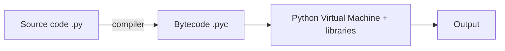

problem set: lec1,2: lec3,4: lec5,6: lec7,8:

# ==🔴Lecture 1==

## Programming Languages

- **Program** = instructions in the computer's instruction set · **Programming** = writing them
- Syntax must be exact → `print(5 + 5)`
- Abstraction levels (top → bottom): **Natural language → High-level → Low-level → Machine language** (bits: 0s & 1s)

| Feature         | High-level | Low-level |
| --------------- | ---------- | --------- |
| Instruction set | Larger     | Smaller   |
| Writing         | Easier     | Harder    |
| Code length     | Shorter    | Longer    |
| Speed           | Slower     | Faster    |

- **Python** = high-level + fast low-level libraries → best of both worlds
- **Compiler**: high/low-level code → machine language

## How a Computer Runs a Program (Chef Analogy)

|Computer|Kitchen|Role|
|---|---|---|
|CPU|Chef|Brain, executes|
|Memory (RAM)|Counter|Temporary, while processing|
|Storage|Pantry / shelves|Long-term files & programs|
|Program|Recipe|Instructions|
|Input|Ingredients||
|Output|Finished dish||

## How Python Runs



## Scripts vs Notebooks

|Feature|Script `.py`|Notebook `.ipynb`|
|---|---|---|
|Runs|Whole file, from terminal|Cell by cell, any order|
|Written in|IDE|Colab / Jupyter|
|Good for|Reusable programs, big projects|Learning, ML/AI (code + text + output)|

- Run a script: `python hello.py`
- Cell types: **Code** (runs Python) · **Markdown** (text, headings, equations, images)

> [!warning] Notebook pitfalls
> 
> - Run order matters (cell 5 before cell 2 → error if it depends on it)
> - Editing an earlier cell doesn't update later outputs
> - Stale values in memory can mess up results
> - **Fix:** restart session → run all, top to bottom

## Google Colab

- Browser-based, no install, runs on Google Cloud
- Code + text + output in one shareable notebook
- Datasets: upload or mount from Google Drive
- Free GPUs / TPUs
- Flow: browser → code to cloud runtime → executes → output back

> [!danger] Runtime is temporary
> 
> - **Lost** when runtime stops / disconnects / times out: uploaded datasets, generated files, trained model weights → **download them**
> - **Kept** (saved to Drive): notebook code, displayed outputs, markdown

## Course Path

Colab → notebooks (concepts, examples, notes) → small code for core concepts → **VS Code** for larger projects

## Quick Recall

- Python compiles to? → **bytecode `.pyc`**
- Runs the bytecode? → **PVM**
- Why is Python fast? → **low-level libraries**
- RAM? → **counter** · Storage? → **pantry** · CPU? → **chef**
- Notebook cell types? → **code & markdown**
- Lost after Colab runtime ends? → **data, files, model weights** (not the notebook)
- Weird notebook results? → **restart & run all**

Source: [Lecture 1 video](https://youtu.be/E8kMWobEoXI)

# ==🔴Lecture 2==

## Print

- `print()` = built-in function → shows output on screen
- Strings go in quotes `'...'` or `"..."` (be consistent) → quotes aren't printed
- Prints any type: `print("Python is fun")`, `print(42)`, `print(3.14)`, `print(True)`
- Multiple values → separate with commas: `print("Name:", "Aisha", "Age:", 20)`

|Argument|Default|Example|
|---|---|---|
|`sep` (between values)|space `" "`|`print("a", "b", sep="-")` → `a-b`|
|`end` (after the print)|new line `"\n"`|`print("Hello", end=" ")` → next print stays on same line|

- **Comments** start with `#` → ignored by Python, for humans

## Variables

- Variable = name that refers to a value → store now, use later
- `=` is **assignment**, not math equality → `student_name = "Aisha"`, `age = 20`
- Read a variable by its name → `print(age + 1)`
- `score = score + 5` → reads old value (90), adds 5, stores 95
- Python variables can change type (`x = 10` → `x = "ten"`) → allowed, but need a good reason

### Data Types

|Type|Meaning|Example|
|---|---|---|
|`int`|Whole number|`40`, `2026`, `-5`|
|`float`|Decimal number|`19.9`, `4.0`, `-0.05`|
|`str`|Text|`"Aisha"`|
|`bool`|True / False|`True`|
|`None`|Empty, no data (NoneType)|`None`|

- Check type → `type(3.5)` → `float`
- `7` is `int`, `7.0` is `float` → same value, different type

### Naming Rules

- Only letters, digits, `_`
- Can't start with a digit · no spaces · case-sensitive · no Python keywords
- Convention: `snake_case`, meaningful names, `ALL_CAPS` only for constants

|Name|Verdict|
|---|---|
|`final_score = 88`|✅ Good|
|`MAX_ATTEMPTS = 3`|✅ Good (constant)|
|`2score = 88`|❌ Starts with a digit|
|`student count = 30`|❌ Has a space|
|`x = 88`|⚠️ Legal but meaningless|

## Numbers & Arithmetic

|Operator|Meaning|Example|
|---|---|---|
|`+` `-` `*`|Add, subtract, multiply|`2 * 3` → `6`|
|`/`|Division (always float)|`10 / 2` → `5.0`|
|`//`|Floor division (integer part)|`130 // 60` → `2`|
|`%`|Remainder|`130 % 60` → `10`|
|`**`|Power|`2 ** 3` → `8`|

- `^` is **not** power in Python (it is in MATLAB) → use `**`
- 130 min = 2 h 10 min → $130 = 2 \times 60 + 10$

> [!warning] Number surprises
> 
> - `/` always returns a float → `10 / 2` → `5.0`
> - int + float → float → `2 + 3.0` → `5.0`

### Casting

|Code|Result|Note|
|---|---|---|
|`int(7.9)`|`7`|Cuts decimals, **no rounding** → use `round()`|
|`float(7)`|`7.0`||
|`str(100)`|`"100"`||
|`int("100")`|`100`|String must hold a whole number|
|`int("hello")`|❌ Error|Not a number|

## Strings

- Quotes: `'...'` or `"..."` (start & end the same) · `"""..."""` for multi-line
- String with `'` inside → wrap in `"` → `"She said 'hello'"`
- `"42"` is a string, not a number
- `+` joins strings (concatenation) → `"Py" + "thon"` → `"Python"`

### Methods

- Method = function attached to a value → `value.method()`

|Method|Does|
|---|---|
|`.upper()`|ALL UPPERCASE|
|`.lower()`|all lowercase|
|`.title()`|Capitalize Each Word|
|`.strip()`|Remove spaces at both ends → `" python "` → `"python"`|
|`.replace(a, b)`|Replace a with b → `"050-123-4567".replace("-", " ")`|
|`.isnumeric()`|`True` only if all digits (no `-`, no `.`)|
|`len(s)`|Number of characters (function, not method)|

- Chained methods run left → right → `raw.strip().lower()` = strip first, then lower

### Indexing

- Starts at **0** → `word = "Python"` → `word[3]` → `"h"`
- Negative counts from the end → `word[-1]` → `"n"`, `word[-2]` → `"o"`
- Index too big → **IndexError** (out of range)

### Slicing

- Format: `text[start:stop:step]` → **stop is not included**
- `word = "programming"`

|Slice|Result|
|---|---|
|`word[0:3]`|`"pro"`|
|`word[3:7]`|`"gram"`|
|`word[-4:]`|`"ming"`|
|`word[:-4]`|`"program"`|
|`word[0:8:2]`|`"porm"` (every 2nd char)|

> [!warning] Strings are immutable
> 
> - Can't change part of a string → `word[0] = "J"` → ❌ error
> - Make a new one → `"J" + word[1:]` → `"Jython"`
> - Or overwrite the whole thing → `word = "Jython"`

### f-strings

- Old way: `print("Student:", name, "scored", score)` → tedious
- f-string: `print(f"Student: {name} scored {score}")` → anything in `{}` gets evaluated
- Use f-strings wherever possible

## Comparison Operators

|Operator|Meaning|Example|
|---|---|---|
|`==`|Equal|`75 == 75` → `True`|
|`!=`|Not equal|`"Ali" != "Aisha"` → `True`|
|`<` `>`|Less / greater|`3 < 5` → `True`|
|`<=` `>=`|Less or equal / greater or equal|`5 >= 5` → `True`|

- `=` assigns, `==` compares
- Result is always a bool (`True` / `False`)

## Errors

- Errors are normal → e.g. `a / b` with `b = 0` → **ZeroDivisionError**
- Python shows a **traceback** → long, but read it from the bottom

> [!tip] Reading a traceback
> 
> 1. **Last line** → what went wrong (e.g. `ZeroDivisionError: division by zero`)
> 2. **Line above** → where it happened → go fix that line

## Quick Recall

- Default `sep`? → **space** · default `end`? → **new line**
- Comment symbol? → **`#`**
- `=` vs `==`? → **assign** vs **compare**
- `10 / 2`? → **`5.0`** · `2 + 3.0`? → **`5.0`**
- `130 // 60` · `130 % 60`? → **`2`** · **`10`**
- Power operator? → **`**`** (not `^`)
- `int(7.9)`? → **`7`** (cuts, doesn't round)
- First index? → **`0`** · last char? → **`[-1]`**
- `"programming"[0:3]`? → **`"pro"`** (stop not included)
- Change `word[0]`? → **no, strings are immutable**
- `"-5".isnumeric()`? → **`False`**
- Variable name starting with a digit? → **not allowed**
- Traceback: read which line first? → **the last line**

Source: [Lecture 2 video](https://youtu.be/7xtf7ToKJ58)

# ==🔴Lecture 3==

## Containers

- One variable = one value → **container** = many values under one name

|Container|Syntax|Ordered|Changeable|Duplicates|
|---|---|---|---|---|
|List|`[1, 2, 3]`|✅|✅|✅|
|Tuple|`(1, 2, 3)`|✅|❌|✅|
|Dict|`{"a": 1}`|by key|✅|keys unique|
|Set|`{1, 2, 3}`|❌|✅|❌|

## Lists

- `scores = [88, 92, 75]` · empty → `[]` · can mix types
- Indexing & slicing work like strings → `scores[0]` → `88`, `scores[-1]` → `75`, `scores[0:2]` → `[88, 92]`
- Lists are **mutable** → `scores[1] = 95` ✅ (strings can't do this)
- `len(scores)` → number of items

### Growing a List

|Method|Does|Example|
|---|---|---|
|`.append(x)`|Add one item at the end|`scores.append(70)`|
|`.extend([...])`|Add many items at the end|`scores.extend([60, 99])`|
|`.insert(i, x)`|Add at position `i`|`scores.insert(0, 100)`|
|`+`|Join two lists → new list|`[1, 2] + [3]` → `[1, 2, 3]`|

### Sorting

|Code|Result|
|---|---|
|`scores.sort()`|Sorts **in place** → changes `scores`, returns `None`|
|`sorted(scores)`|Returns a **new** sorted list → original unchanged|
|`reverse=True`|Descending → `sorted(scores, reverse=True)`|

> [!warning] `x = scores.sort()` → `x` is `None` Use `sorted()` when you want the result in a new variable.

### Copying

> [!danger] `b = a` is NOT a copy Both names point to the **same** list → changing `b` changes `a` too.

```python
a = [1, 2, 3]
b = a
b.append(4)
print(a)   # [1, 2, 3, 4]  ← a changed too!
```

- Real copy → `b = a.copy()` or `b = a[:]` or `b = list(a)`

## Tuples

- Like a list, but **immutable** → for **fixed records**
- `student = ("Aisha", 20, "CS")` → `student[0]` → `"Aisha"`
- `student[1] = 21` → ❌ error
- **Unpacking** → `name, age, major = student`

## Dictionaries

- **Key → value** pairs → look up by **name**, not position
- `ages = {"Aisha": 20, "Omar": 22}`

|Code|Does|
|---|---|
|`ages["Aisha"]`|Get value → `20`|
|`ages["Sara"] = 19`|Add new key, or update if it exists|
|`ages.get("Ali")`|Safe get → `None` if missing (no error)|
|`ages.get("Ali", 0)`|Safe get with default → `0`|
|`"Aisha" in ages`|Checks **keys** → `True`|
|`.keys()` · `.values()` · `.items()`|All keys · all values · (key, value) pairs|

- Missing key with `[]` → **KeyError** → use `.get()`
- Keys must be unique & immutable (str, int, tuple)

## Sets

- `fruits = {"apple", "banana"}` · empty → `set()` (`{}` is an empty **dict**!)
- **No duplicates**, **no order**, **no indexing** → `fruits[0]` ❌
- Main use → **fast membership** → `"apple" in fruits`
- Remove duplicates → `set([1, 1, 2])` → `{1, 2}`
- Add → `fruits.add("cherry")`

## Choosing a Container

|Need|Use|
|---|---|
|Ordered collection that changes|**List**|
|Fixed record that shouldn't change|**Tuple**|
|Look up a value by name / key|**Dict**|
|Unique items, fast "is it in?"|**Set**|

## Quick Recall

- `[1, 2]` · `(1, 2)` · `{"a": 1}` · `{1, 2}`? → **list · tuple · dict · set**
- `.append` vs `.extend`? → **one item** vs **many items**
- `.sort()` vs `sorted()`? → **in place, returns `None`** vs **new list**
- `b = a` then `b.append(4)` → `a` changes? → **yes, same list** → use `.copy()`
- Can you change a tuple? → **no, immutable**
- Get a dict value safely? → **`.get(key)`**
- `"Aisha" in ages` checks? → **keys**
- Empty set? → **`set()`** (not `{}`)
- Set index `s[0]`? → **not allowed**
- Fixed record? → **tuple** · lookup by name? → **dict** · unique / membership? → **set**

Source: [Lecture 3 video](https://youtu.be/KdTHcdyDHtA)

# ==🔴Lecture 4==

## Input

- `input("prompt")` → waits for the user to type, then continues
- Always returns a **string** → cast for numbers → `age = int(input("Age: "))`

> [!warning] `input()` is always `str` `"5" + "3"` → `"53"`, not `8` → cast first with `int()` / `float()`

## if / elif / else

```python
score = 85
if score >= 90:
    print("A")
elif score >= 80:
    print("B")
else:
    print("C")
```

- Checked **top → bottom** → the **first** True branch runs, the rest are skipped
- `elif` (as many as needed) & `else` (catch-all) are optional
- Condition = anything that gives `True` / `False` (comparison operators from Lecture 2)

## Indentation

- Line ends with a colon `:` → the block under it is **indented** (4 spaces)
- Indentation is **part of the syntax**, not style → wrong/missing → **IndentationError**
- Back at the outer level → code runs no matter what the condition was

## Logical Operators

|Operator|True when|Example|
|---|---|---|
|`and`|**Both** are True|`age >= 18 and has_id`|
|`or`|**At least one** is True|`day == "Fri" or day == "Sat"`|
|`not`|Flips the value|`not is_banned`|

### Short-Circuit Evaluation

- `and` → stops at the first **False** · `or` → stops at the first **True** → the right side isn't evaluated
- Use it as a guard → `if b != 0 and a / b > 2:` → no ZeroDivisionError

### Truthiness

- Any value can be used as a condition

|Falsy|Truthy|
|---|---|
|`False`, `None`, `0`, `0.0`, `""`, `[]`, `()`, `{}`, `set()`|Everything else → `"0"`, `" "`, `[0]`, `-1`|

- `if name:` → means "if `name` is not empty"

## Validate Input First

- Pattern: **check the input → reject if bad → only then do the main work**

```python
age_text = input("Age: ")
if not age_text.isnumeric():
    print("Please enter a whole number")
else:
    age = int(age_text)
    print(f"Next year you'll be {age + 1}")
```

- `.isnumeric()` check → prevents `int("hello")` crashing the program

## Quick Recall

- `input()` returns? → **always `str`**
- Number from input? → **`int(input())`**
- How many branches run in an if/elif/else? → **at most one** (the first True)
- What marks a block? → **colon `:` + indentation**
- Bad indentation? → **IndentationError**
- `True and False` · `True or False` · `not True`? → **`False`** · **`True`** · **`False`**
- Why is `b != 0 and a / b > 2` safe? → **short-circuit** → division skipped if `b == 0`
- Falsy values? → **`False`, `None`, `0`, `""`, empty containers**
- `bool("0")`? → **`True`** (non-empty string)
- Validate before `int()`? → **`.isnumeric()`**

Source: [Lecture 4 video](https://youtu.be/2ksKjayR0eM) 