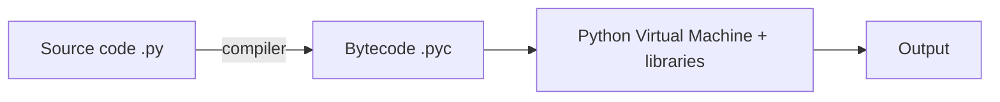

# Lecture 1

## Programming Languages

- **Program** = instructions in the computer's instruction set · **Programming** = writing them
- Syntax must be exact → `print(5 + 5)`
- Abstraction levels (top → bottom): **Natural language → High-level → Low-level → Machine language** (bits: 0s & 1s)

||High-level|Low-level|
|---|---|---|
|Instruction set|Larger|Smaller|
|Writing|Easier|Harder|
|Code length|Shorter|Longer|
|Speed|Slower|Faster|

- **Python** = high-level + fast low-level libraries → best of both worlds
- **Compiler**: high/low-level code → machine language

## How a Computer Runs a Program (Chef Analogy)

|Computer|Kitchen|Role|
|---|---|---|
|CPU|Chef|Brain, executes|
|Memory (RAM)|Counter|Temporary, while processing|
|Storage|Pantry / shelves|Long-term files & programs|
|Program|Recipe|Instructions|
|Input|Ingredients||
|Output|Finished dish||

## How Python Runs

## Scripts vs Notebooks

||Script `.py`|Notebook `.ipynb`|
|---|---|---|
|Runs|Whole file, from terminal|Cell by cell, any order|
|Written in|IDE|Colab / Jupyter|
|Good for|Reusable programs, big projects|Learning, ML/AI (code + text + output)|

- Run a script: `python hello.py`
- Cell types: **Code** (runs Python) · **Markdown** (text, headings, equations, images)

> [!warning] Notebook pitfalls
> 
> - Run order matters (cell 5 before cell 2 → error if it depends on it)
> - Editing an earlier cell doesn't update later outputs
> - Stale values in memory can mess up results
> - **Fix:** restart session → run all, top to bottom

## Google Colab

- Browser-based, no install, runs on Google Cloud
- Code + text + output in one shareable notebook
- Datasets: upload or mount from Google Drive
- Free GPUs / TPUs
- Flow: browser → code to cloud runtime → executes → output back

> [!danger] Runtime is temporary **Lost** when runtime stops / disconnects / times out: uploaded datasets, generated files, trained model weights → **download them** **Kept** (saved to Drive): notebook code, displayed outputs, markdown

## Course Path

Colab → notebooks (concepts, examples, notes) → small code for core concepts → **VS Code** for larger projects

## Quick Recall

- Python compiles to? → **bytecode `.pyc`**
- Runs the bytecode? → **PVM**
- Why is Python fast? → **low-level libraries**
- RAM? → **counter** · Storage? → **pantry** · CPU? → **chef**
- Notebook cell types? → **code & markdown**
- Lost after Colab runtime ends? → **data, files, model weights** (not the notebook)
- Weird notebook results? → **restart & run all**

Source: [Lecture 1 video](https://youtu.be/E8kMWobEoXI)

# Lecture 2