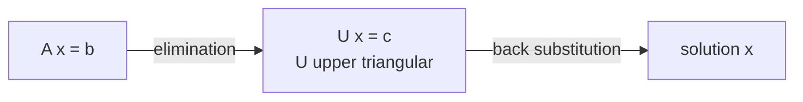

# 1.1 Vectors

## Course Route

Vectors & geometry → Matrices → Systems of linear equations → Column space, rank, projections → Least squares & linear regression

- Each module ends with 6 exercises → do them
- Module 1 goal: similarities, distances, simple predictions

## What Is a Vector

- **Vector** = ordered list of numbers → **entries / components**
- Written as a column $\begin{bmatrix} x_1 \ \vdots \ x_n \end{bmatrix}$ or a row $(x_1, \dots, x_n)$
- **Size = dimension** = number of entries → $\mathbf{x} \in \mathbb{R}^n$
- Data point = vector → house $\mathbf{x} = \begin{bmatrix} 120 \ 3 \end{bmatrix} \in \mathbb{R}^2$
    - $x_1$ = area (m²), $x_2$ = bedrooms

## Notation

- **Bold** letter = vector: $\mathbf{x}, \mathbf{a}, \mathbf{u}$
- $u_i$ = the $i$-th entry → indices $1 \dots n$ (Python: $0 \dots n-1$)
- $\mathbf{u}_i$ (bold) = the $i$-th vector in a list $\mathbf{u}_1, \dots, \mathbf{u}_k$

## Special Vectors

|Vector|Notation|Example in $\mathbb{R}^3$|
|---|---|---|
|Zero|$\mathbf{0}$ or $\mathbf{0}_n$|$(0, 0, 0)$|
|Ones|$\mathbf{1}$ or $\mathbf{1}_n$|$(1, 1, 1)$|
|Standard unit|$\mathbf{e}_i$ → 1 at position $i$, 0 elsewhere|$\mathbf{e}_1 = (1,0,0)$, $\mathbf{e}_2 = (0,1,0)$, $\mathbf{e}_3 = (0,0,1)$|

- $\mathbf{e}_1, \mathbf{e}_2, \mathbf{e}_3$ = the old $\hat{i}, \hat{j}, \hat{k}$ axes

## Addition

- Same size only → add entry by entry: $\mathbf{u} + \mathbf{v} = (u_1 + v_1, \dots, u_n + v_n)$
- Geometry → diagonal of the parallelogram formed by $\mathbf{u}$ and $\mathbf{v}$

## Scaling

- $c\mathbf{u} = (cu_1, \dots, cu_n)$, with $c \in \mathbb{R}$

|Scalar|Effect|
|---|---|
|$c > 1$|Longer, same direction|
|$0 < c < 1$|Shorter, same direction|
|$c < 0$|Flips direction ($-\mathbf{u}$: same length, opposite way)|
|$c = 0$|Zero vector|

- **Subtraction** = scale, then add → $\mathbf{u} - \mathbf{v} = \mathbf{u} + (-1)\mathbf{v}$

## Linear Combinations

- Scale vectors, then add them: $c_1\mathbf{u}_1 + c_2\mathbf{u}_2 + \dots + c_m\mathbf{u}_m$
- $c_i$ = **coefficients**
- Example: $2\mathbf{u} + 3\mathbf{v}$ → diagonal of the parallelogram of $2\mathbf{u}$ and $3\mathbf{v}$

## Span

- **Span** = set of all linear combinations → $\text{span}(\mathbf{u}, \mathbf{v}) = { c\mathbf{u} + d\mathbf{v} : c, d \in \mathbb{R} }$

|Nonzero vectors|All combinations give|
|---|---|
|One: $c\mathbf{u}$|A **line** through the origin|
|Two: $c\mathbf{u} + d\mathbf{v}$|A **plane** through the origin|

- Always through the origin → $c = d = 0$ gives $\mathbf{0}$

> [!warning] Two vectors → plane only if they're not parallel If $\mathbf{v}$ is a multiple of $\mathbf{u}$, the span is still just a line.

## Example: RGB Colors

- $\mathbf{r} = (1, 0, 0)$, $\mathbf{g} = (0, 1, 0)$, $\mathbf{b} = (0, 0, 1)$
- Yellow → $\mathbf{r} + \mathbf{g} = (1, 1, 0)$
- Gray → $0.5\mathbf{r} + 0.5\mathbf{g} + 0.5\mathbf{b} = (0.5, 0.5, 0.5)$
- Every color = a linear combination of $\mathbf{r}, \mathbf{g}, \mathbf{b}$

## Quick Recall

- Dimension of $(3, -1, 4, 0)$? → **4**
- $\mathbf{e}_2$ in $\mathbb{R}^3$? → $(0, 1, 0)$
- $2(1, 3) + 3(2, -1)$? → $(2, 6) + (6, -3) = (8, 3)$
- $\mathbf{u} - \mathbf{v}$ as a combination? → $\mathbf{u} + (-1)\mathbf{v}$
- What does $c < 0$ do? → **flips direction**
- Span of one nonzero vector? → **line** through the origin
- Span of two non-parallel vectors? → **plane** through the origin
- Why does a span always contain $\mathbf{0}$? → all coefficients $= 0$
- Yellow in RGB? → $(1, 1, 0)$

Source: [1.1 Vectors video](https://youtu.be/FeCxx5-q94Y)

# 1.2 Dot Product and Distance

## Dot Product

- Multiply matching entries, then add → **one number**
- $\mathbf{u} \cdot \mathbf{v} = \mathbf{u}^T\mathbf{v} = u_1v_1 + u_2v_2 + \dots + u_nv_n$
- $\mathbf{u}^T$ = **transpose** → column becomes row (and row becomes column)
- Example: $(1, 2) \cdot (3, -1) = 1 \cdot 3 + 2 \cdot (-1) = 1$
- Both vectors must have the **same size**

## Prediction as a Weighted Sum

- $\hat{y} = \mathbf{w}^T\mathbf{x} + b$
    - $\mathbf{x}$ = features, $\mathbf{w}$ = weights, $b$ = **bias**
    - Each feature × its weight, then add, then add the bias
- Example: $\mathbf{x} = (4, 3)$, $\mathbf{w} = (2, -1)$ → $\mathbf{w}^T\mathbf{x} = 8 - 3 = 5$ → $\hat{y} = 5 + b$

## Norm (Length)

- $\lVert \mathbf{u} \rVert = \sqrt{u_1^2 + \dots + u_n^2} = \sqrt{\mathbf{u} \cdot \mathbf{u}}$ → **Euclidean norm**
- **Unit vector** → norm $= 1$
- $\lVert c\mathbf{u} \rVert = \lvert c \rvert , \lVert \mathbf{u} \rVert$ → e.g. $\lVert -2\mathbf{u} \rVert = 2\lVert \mathbf{u} \rVert$
- $\lVert \mathbf{u} \rVert \ge 0$, and $= 0$ only if $\mathbf{u} = \mathbf{0}$
- **Triangle inequality**: $\lVert \mathbf{u} + \mathbf{v} \rVert \le \lVert \mathbf{u} \rVert + \lVert \mathbf{v} \rVert$ → going straight is never longer than a detour

## Distance

- $\text{dist}(\mathbf{u}, \mathbf{v}) = \lVert \mathbf{u} - \mathbf{v} \rVert$ (order doesn't matter)
- Example: $\mathbf{u} = (1, 2)$, $\mathbf{v} = (4, 6)$ → $\mathbf{v} - \mathbf{u} = (3, 4)$ → $\sqrt{9 + 16} = 5$

## Angle & Cosine Similarity

- $\cos\theta = \dfrac{\mathbf{u}^T\mathbf{v}}{\lVert \mathbf{u} \rVert , \lVert \mathbf{v} \rVert}$ → same as $\mathbf{u}^T\mathbf{v} = \lVert \mathbf{u} \rVert , \lVert \mathbf{v} \rVert \cos\theta$
- Range $-1$ to $1$:

|$\cos\theta$|Angle|Meaning|
|---|---|---|
|$1$|$0°$|Same direction (length can differ)|
|$0$|$90°$|**Orthogonal** (perpendicular)|
|$-1$|$180°$|Opposite directions|

- Undefined if either vector is $\mathbf{0}$

## Normalization

- $\hat{\mathbf{x}} = \dfrac{\mathbf{x}}{\lVert \mathbf{x} \rVert}$ ($\mathbf{x} \ne \mathbf{0}$) → keeps the direction, removes the length
- Example: $(3, 4)$ → norm $5$ → $(0.6, 0.8)$, norm $1$

## Example: Nearest Direction

- Query $\mathbf{q} = (1, 1)$; candidates $\mathbf{a} = (2, 0)$, $\mathbf{b} = (3, 3)$
- $\cos(\mathbf{q}, \mathbf{a}) = \dfrac{2}{\sqrt{2} \cdot 2} = \dfrac{1}{\sqrt{2}} \approx 0.71$
- $\cos(\mathbf{q}, \mathbf{b}) = \dfrac{6}{\sqrt{2} \cdot \sqrt{18}} = 1$ → $\mathbf{b}$ points the same way as $\mathbf{q}$

> [!note] Slide typo The slide says 0.77; the correct value is $\frac{1}{\sqrt{2}} \approx 0.71$.

## Distance vs Similarity

- **Distance** → how close are the points? (location)
- **Cosine similarity** → how aligned are the directions? (direction)
- $(1, 1)$ and $(10, 10)$ → cosine $= 1$, but distance $= 9\sqrt{2} \approx 12.7$

## Quick Recall

- $(1, 2) \cdot (3, -1)$? → **1**
- What does $\mathbf{u}^T$ do? → turns a column into a row
- $\lVert (3, 4) \rVert$? → **5**
- $\lVert -3\mathbf{u} \rVert$? → $3\lVert \mathbf{u} \rVert$
- Distance formula? → $\lVert \mathbf{u} - \mathbf{v} \rVert$
- $\cos\theta = 0$ means? → **orthogonal**
- Normalize $(3, 4)$? → $(0.6, 0.8)$
- Same direction but far apart → which measure says "similar"? → **cosine similarity**

Source: [1.2 video](https://youtu.be/d8QfPSsedRY)

# 2.1 Matrices and Matrix Operations

## What Is a Matrix

- Rectangular array of numbers → **entries**
- **Size** $m \times n$ → $m$ rows, $n$ columns (rows first)
- $a_{ij}$ → row $i$, column $j$ (math starts at 1, Python at 0)

$$A = \begin{bmatrix} a_{11} & a_{12} & \cdots & a_{1n} \ \vdots & \vdots & \ddots & \vdots \ a_{m1} & a_{m2} & \cdots & a_{mn} \end{bmatrix}$$

## Shapes

|Shape|Condition|Example size|
|---|---|---|
|Tall|$m > n$ (more rows)|$4 \times 2$|
|Wide|$m < n$ (more columns)|$2 \times 3$|
|Square|$m = n$|$3 \times 3$|

## Matrices in Real Life

- Grayscale image → each pixel is a number from $0$ (black) to $1$ (white)
- Price table → $p_{ij}$ = price vendor $j$ charges for good $i$

## Special Matrices

|Matrix|Definition|
|---|---|
|Zero $0$|All entries $0$ (any size)|
|Identity $I$|Square, $1$ on the diagonal, $0$ elsewhere|
|Sparse|Most entries are $0$ → stored efficiently|
|Diagonal|Square, $a_{ij} = 0$ when $i \ne j$|
|Lower triangular|Square, $a_{ij} = 0$ when $i < j$ (zeros above the diagonal)|
|Upper triangular|Square, $a_{ij} = 0$ when $i > j$ (zeros below the diagonal)|

- **Main diagonal** → $a_{11}, a_{22}, \dots, a_{nn}$
- Lower + upper triangular at the same time → **diagonal**

## Transpose

- $A^T$ → rows become columns, columns become rows → $m \times n$ becomes $n \times m$
- Example: $A = \begin{bmatrix} 0 & 3 \ 6 & 1 \ 2 & -1 \end{bmatrix}$ ($3 \times 2$) → $A^T = \begin{bmatrix} 0 & 6 & 2 \ 3 & 1 & -1 \end{bmatrix}$ ($2 \times 3$)
- Row vector → transpose → column vector (and vice versa)
- **Symmetric** → $A^T = A$ → must be square, $a_{ij} = a_{ji}$ (mirror across the diagonal)

## Addition & Scalar Multiplication

- $A + B$ → **same size only**, add matching entries
- $kA$ → multiply every entry by $k$
- Properties: $A + B = B + A$ · $k(A + B) = kA + kB$ · $(A + B)^T = A^T + B^T$

## Example

- $A = \begin{bmatrix} -1 & 0 & 0 \ 2 & 3 & 0 \end{bmatrix}$, $B = \begin{bmatrix} 1 & -1 & 1 \ 3 & 1 & 0 \end{bmatrix}$, $C$ is $2 \times 2$
- $A + B = \begin{bmatrix} 0 & -1 & 1 \ 5 & 4 & 0 \end{bmatrix}$
- $-2A + B = \begin{bmatrix} 2 & 0 & 0 \ -4 & -6 & 0 \end{bmatrix} + B = \begin{bmatrix} 3 & -1 & 1 \ -1 & -5 & 0 \end{bmatrix}$
- $A + C$ → ❌ different sizes

## Quick Recall

- Size of a matrix with 3 rows, 4 columns? → $3 \times 4$
- $a_{23}$? → row 2, column 3
- Tall vs wide? → tall $m > n$, wide $m < n$
- Lower triangular → which entries are $0$? → above the diagonal ($i < j$)
- Transpose of a $3 \times 2$? → $2 \times 3$
- Symmetric means? → $A^T = A$
- Can you add $2 \times 3$ and $2 \times 2$? → **no** Source: [2.1 video](https://youtu.be/6HzOv2qICRo)

# 2.2 Product of Matrices

## From Equations to $A\mathbf{x} = \mathbf{b}$

- System: $x_1 + 3x_2 + x_3 = 1$ and $2x_1 - x_2 + x_3 = 1$

$$\underbrace{\begin{bmatrix} 1 & 3 & 1 \ 2 & -1 & 1 \end{bmatrix}}_{A} \underbrace{\begin{bmatrix} x_1 \ x_2 \ x_3 \end{bmatrix}}_{\mathbf{x}} = \underbrace{\begin{bmatrix} 1 \ 1 \end{bmatrix}}_{\mathbf{b}}$$

- Each row of $A$ = coefficients of one equation

## Two Ways to Read $A\mathbf{x}$

1. **Rows** → a batch of dot products: entry $i$ = $\mathbf{r}_i^T\mathbf{x}$ (row $i$ · $\mathbf{x}$)
    
2. **Columns** → a linear combination of the columns of $A$:
    
    $$A\mathbf{x} = x_1\mathbf{a}_1 + x_2\mathbf{a}_2 + \dots + x_n\mathbf{a}_n$$
    

- The column view comes back in modules 3, 4 and 5 → important
- $A\mathbf{e}_1$ = the **first column** of $A$ → e.g. $A\mathbf{e}_1 = (1, 2)$ above

## Matrix × Matrix

- **Rule**: columns of the left = rows of the right
- $(m \times n)(n \times l) \to (m \times l)$ → the middle $n$ must match and disappears
- Entry $(i, j)$ of $AB$ = row $i$ of $A$ · column $j$ of $B$

**Example**

$$\begin{bmatrix} 2 & -1 & 0 \ 1 & -1 & 1 \end{bmatrix} \begin{bmatrix} 0 & -2 \ 1 & 0 \ 1 & -1 \end{bmatrix} = \begin{bmatrix} -1 & -4 \ 0 & -3 \end{bmatrix}$$

- $(2 \times 3)(3 \times 2) \to 2 \times 2$
- Entry $(1,1)$: $2 \cdot 0 + (-1) \cdot 1 + 0 \cdot 1 = -1$

## Properties

- $AI = IA = A$
- **Not commutative** → in general $AB \ne BA$ (equal only in special cases, e.g. when one is $I$)

> [!warning] The lecture says $AB$ is _never_ equal to $BA$ The correct statement: it is _not always_ equal. Sometimes it is (e.g. $AI = IA$).

## Inverse

- Square $A$ is **invertible** (non-singular) if some $B$ gives $AB = BA = I$ → $B = A^{-1}$
- Like numbers: $2 \cdot \frac{1}{2} = 1$
- $A^{-1}$ **undoes** what $A$ does

**$2 \times 2$ formula**

$$A = \begin{bmatrix} a & b \ c & d \end{bmatrix}, \quad \det A = ad - bc \ne 0 \quad \Rightarrow \quad A^{-1} = \frac{1}{ad - bc} \begin{bmatrix} d & -b \ -c & a \end{bmatrix}$$

- Swap the diagonal, negate the other two, divide by the determinant
- If $ad - bc = 0$ → no inverse

**Example**

- $A = \begin{bmatrix} 2 & 1 \ 1 & 1 \end{bmatrix}$ → $\det A = 2 - 1 = 1$ → $A^{-1} = \begin{bmatrix} 1 & -1 \ -1 & 2 \end{bmatrix}$

## Quick Recall

- $A\mathbf{x}$ as rows? → dot products of each row with $\mathbf{x}$
- $A\mathbf{x}$ as columns? → $x_1\mathbf{a}_1 + \dots + x_n\mathbf{a}_n$
- $A\mathbf{e}_1$? → the first column of $A$
- $(2 \times 3)(3 \times 4)$? → $2 \times 4$
- $(2 \times 3)(2 \times 3)$? → ❌ not allowed
- Is $AB = BA$ always? → **no**
- When does a $2 \times 2$ have no inverse? → $ad - bc = 0$
- Inverse of $\begin{bmatrix} 2 & 1 \ 1 & 1 \end{bmatrix}$? → $\begin{bmatrix} 1 & -1 \ -1 & 2 \end{bmatrix}$

Source: [2.2 video](https://youtu.be/YLSydzA_PFk)

# 3.1 Systems of Linear Equations

## Linear vs Nonlinear

- **Linear equation** in $n$ variables → $a_1x_1 + a_2x_2 + \dots + a_nx_n = b$
- Only allowed: multiply each variable by a constant, then add the terms

|Linear ✅|Nonlinear ❌|Why|
|---|---|---|
|$2x_1 + 3x_2 = 5$|$x_1^2 + x_2 = 5$|Power of a variable|
|$x_1 - 4x_2 + x_3 = 0$|$x_1x_2 = 3$|Product of two variables|
||$\sin x_1 + x_2 = 1$|Function of a variable|

- Also not allowed → absolute value $\lvert x_1 \rvert$

## System of Linear Equations

- $m$ equations, $n$ variables:

$$\begin{aligned} a_{11}x_1 + a_{12}x_2 + \dots + a_{1n}x_n &= b_1 \ a_{21}x_1 + a_{22}x_2 + \dots + a_{2n}x_n &= b_2 \ &\ \ \vdots \ a_{m1}x_1 + a_{m2}x_2 + \dots + a_{mn}x_n &= b_m \end{aligned}$$

- $a_{ij}$ → $i$ = which **equation**, $j$ = which **variable** ($a_{ij}$ = coefficient of $x_j$ in equation $i$)
- Coefficients look like matrix entries → that's the point

## Matrix Form $A\mathbf{x} = \mathbf{b}$

- Record the coefficients of each equation as a **row** of $A$

$$\begin{bmatrix} -1 & -1 & 2 \ 2 & 1 & 3 \end{bmatrix} \begin{bmatrix} x_1 \ x_2 \ x_3 \end{bmatrix} = \begin{bmatrix} 1 \ 1 \end{bmatrix}$$

- **Row view** → row $i$ · $\mathbf{x}$ = left side of equation $i$ → $\mathbf{r}_i^T\mathbf{x}$
- **Column view** → $A\mathbf{x} = x_1\mathbf{a}_1 + x_2\mathbf{a}_2 + x_3\mathbf{a}_3$ ($x_j$ always multiplies column $j$)

## Consistent vs Inconsistent

|Term|Meaning|
|---|---|
|**Consistent**|At least one solution → **unique** or **infinitely many**|
|**Inconsistent**|**No** solution (module 5 shows what to do then)|

## Overdetermined → Tall Matrix

- $x_1 + x_2 = 1$, $x_1 = -1$, $x_1 - x_2 = 0$ → 3 equations, 2 unknowns

$$\begin{bmatrix} 1 & 1 \ 1 & 0 \ 1 & -1 \end{bmatrix} \begin{bmatrix} x_1 \ x_2 \end{bmatrix} = \begin{bmatrix} 1 \ -1 \ 0 \end{bmatrix}$$

- Eq. 2 → $x_1 = -1$
- Eq. 1 → $-1 + x_2 = 1$ → $x_2 = 2$
- Eq. 3 → $-1 - x_2 = 0$ → $x_2 = -1$ → ❌ doesn't match → **inconsistent**
- **Overdetermined** = more equations than unknowns → **tall** $A$ ($3 \times 2$) → usually inconsistent

## Underdetermined → Wide Matrix

- $x_1 + x_2 = 1$, $x_2 + x_3 = 2$ → 2 equations, 3 unknowns

$$\begin{bmatrix} 1 & 1 & 0 \ 0 & 1 & 1 \end{bmatrix} \begin{bmatrix} x_1 \ x_2 \ x_3 \end{bmatrix} = \begin{bmatrix} 1 \ 2 \end{bmatrix}$$

- Fix $x_3 \in \mathbb{R}$ (free parameter)
- Eq. 2 → $x_2 = 2 - x_3$
- Eq. 1 → $x_1 = 1 - x_2 = 1 - (2 - x_3) = -1 + x_3$
- → **infinitely many** solutions, $x_1, x_2$ depend on $x_3$
- Could fix $x_2$ instead → but the matrix decides which variable to fix (see 3.3: the **non-pivot** column)

## Geometric Picture (2 Equations, 2 Unknowns)

|System|Lines|Solutions|
|---|---|---|
|$x - y = 0$, $x + y = 1$|Cross at one point|**One** → $\left(\tfrac12, \tfrac12\right)$|
|Eq. 2 = $2 \times$ Eq. 1|Same line (on top of each other)|**Infinitely many**|
|$x - y = -1$, $x - y = 0$|Parallel (same left side, different right side)|**None**|

- First system → add the equations: $2x = 1$ → $x = \tfrac12$, $y = \tfrac12$
- As a combination of the columns:

$$\begin{bmatrix} 1 & -1 \ 1 & 1 \end{bmatrix} \begin{bmatrix} x \ y \end{bmatrix} = \begin{bmatrix} 0 \ 1 \end{bmatrix} \quad \Rightarrow \quad \tfrac12 \begin{bmatrix} 1 \ 1 \end{bmatrix} + \tfrac12 \begin{bmatrix} -1 \ 1 \end{bmatrix} = \begin{bmatrix} 0 \ 1 \end{bmatrix}$$

## Quick Recall

- Is $x_1x_2 = 3$ linear? → **no** (product of variables)
- $a_{21}$ means? → equation 2, coefficient of $x_1$
- Consistent means? → **at least one** solution
- More equations than unknowns? → **overdetermined** → **tall** → usually inconsistent
- Fewer equations than unknowns? → **wide** → free variable → infinitely many
- Two parallel lines? → **no solution**
- Same line twice? → **infinitely many**

Source: [3.1 video](https://youtu.be/prfGqJQnimY)

# 3.2 The Idea of Elimination and Back Substitution

## Strategy

- Square system ($3 \times 3$) → turn $A$ into an **upper triangular** $U$, then solve from the bottom up

## Back Substitution

- Upper triangular system:

$$\begin{aligned} x_1 + 2x_2 + x_3 &= 2 \ -x_2 - x_3 &= 1 \ x_3 &= -4 \end{aligned}$$

1. Last equation → $x_3 = -4$
2. $-x_2 - (-4) = 1$ → $-x_2 = -3$ → $x_2 = 3$
3. $x_1 + 2(3) + (-4) = 2$ → $x_1 + 2 = 2$ → $x_1 = 0$

- Solution → $(x_1, x_2, x_3) = (0, 3, -4)$

## Gaussian Elimination

- **Gaussian elimination** = a sequence of elementary row operations that turns $A$ into $U$
- Row operations must also hit $\mathbf{b}$ → work on the **augmented matrix** $[A \mid \mathbf{b}]$

|Elementary row operation|Example|
|---|---|
|Multiply a row by a **nonzero** constant|$R_3 \leftarrow \tfrac13 R_3$|
|**Add a multiple of one row to another** (most used)|$R_2 \leftarrow R_2 - 2R_1$|
|Swap two rows|$R_2 \leftrightarrow R_3$|

- **Pivot** = first nonzero entry in a row → use it to make **zeros below it**, then move to the next row's pivot
- You can fix any row first → rows can always be swapped

## Example

- Original system: $x_1 + 2x_2 + x_3 = 2$, $2x_1 + 3x_2 + x_3 = 5$, $6x_1 + 4x_2 + x_3 = 8$

$$\left[\begin{array}{ccc|c} 1 & 2 & 1 & 2 \ 2 & 3 & 1 & 5 \ 6 & 4 & 1 & 8 \end{array}\right] \xrightarrow[R_3 \leftarrow R_3 - 6R_1]{R_2 \leftarrow R_2 - 2R_1} \left[\begin{array}{ccc|c} 1 & 2 & 1 & 2 \ 0 & -1 & -1 & 1 \ 0 & -8 & -5 & -4 \end{array}\right]$$

$$\xrightarrow{R_3 \leftarrow R_3 - 8R_2} \left[\begin{array}{ccc|c} 1 & 2 & 1 & 2 \ 0 & -1 & -1 & 1 \ 0 & 0 & 3 & -12 \end{array}\right] \xrightarrow{R_3 \leftarrow \frac13 R_3} \left[\begin{array}{ccc|c} 1 & 2 & 1 & 2 \ 0 & -1 & -1 & 1 \ 0 & 0 & 1 & -4 \end{array}\right]$$

- Pivot of row 1 = $1$ → clears the $2$ and the $6$
- Pivot of row 2 = $-1$ → clears the $-8$
- Result = the upper triangular system above → back substitution gives $(0, 3, -4)$
- Course stays simple → $2 \times 2$, $3 \times 3$, $3 \times 2$ only

## Quick Recall

- Goal of elimination? → turn $A$ into upper triangular $U$
- Then? → **back substitution** (last equation first)
- 3 row operations? → **scale by nonzero**, **add a multiple of another row**, **swap**
- Augmented matrix? → $[A \mid \mathbf{b}]$ → so row ops also change $\mathbf{b}$
- Pivot? → **first nonzero entry** in a row
- To clear the $6$ under pivot $1$? → $R_3 \leftarrow R_3 - 6R_1$

Source: [3.2 video](https://youtu.be/9QkDMKYmEHA)

# 3.3 Examples

## The 3-Step Algorithm

1. Set up the **augmented matrix** $[A \mid \mathbf{b}]$
2. **Gaussian elimination** → row operations until upper triangular / row echelon form
3. **Back substitution**

## Example 1: Infinitely Many Solutions

> [!note] Matrix rebuilt from the row operations The audio garbles some entries; this starting matrix is the one that matches every step and result in the video.

$$\left[\begin{array}{ccc|c} 1 & 2 & 2 & 2 \ 2 & 4 & 6 & 8 \ 3 & 6 & 8 & 10 \end{array}\right] \xrightarrow[R_3 \leftarrow R_3 - 3R_1]{R_2 \leftarrow R_2 - 2R_1} \left[\begin{array}{ccc|c} 1 & 2 & 2 & 2 \ 0 & 0 & 2 & 4 \ 0 & 0 & 2 & 4 \end{array}\right] \xrightarrow[R_2 \leftarrow \frac12 R_2]{R_3 \leftarrow R_3 - R_2} \left[\begin{array}{ccc|c} 1 & 2 & 2 & 2 \ 0 & 0 & 1 & 2 \ 0 & 0 & 0 & 0 \end{array}\right]$$

- Two identical rows → one becomes a row of zeros
- Left with **2 equations, 3 unknowns** → infinitely many solutions
- Pivots → column 1 ($x_1$) and column 3 ($x_3$) → **$x_2$ is free** (non-pivot column)
- $x_3 = 2$
- $x_1 + 2x_2 + 2(2) = 2$ → $x_1 = -2 - 2x_2$, with $x_2 \in \mathbb{R}$

> [!tip] Which variable is free? The one whose column has **no pivot**. That's why $x_3$ was fixed in 3.1: there, columns 1 and 2 had the pivots.

## Example 2: Swapping Rows

> [!warning] The audio drops a minus sign The third equation is read as "2, 1, 2 | 2", but the steps and the final answer only work with $2x_1 - x_2 + 2x_3 = 2$. Also, the scaling of $R_3$ must be by $-\tfrac13$ (not $\tfrac13$) to get $(0, 1, 0 \mid 2)$.

- System: $x_1 + x_2 + x_3 = 4$, $-x_1 - x_2 + x_3 = -2$, $2x_1 - x_2 + 2x_3 = 2$

$$\left[\begin{array}{ccc|c} 1 & 1 & 1 & 4 \ -1 & -1 & 1 & -2 \ 2 & -1 & 2 & 2 \end{array}\right] \xrightarrow[R_3 \leftarrow R_3 - 2R_1]{R_2 \leftarrow R_2 + R_1} \left[\begin{array}{ccc|c} 1 & 1 & 1 & 4 \ 0 & 0 & 2 & 2 \ 0 & -3 & 0 & -6 \end{array}\right] \xrightarrow[R_3 \leftarrow -\frac13 R_3]{R_2 \leftarrow \frac12 R_2} \left[\begin{array}{ccc|c} 1 & 1 & 1 & 4 \ 0 & 0 & 1 & 1 \ 0 & 1 & 0 & 2 \end{array}\right]$$

- Row 3's pivot is **left** of row 2's pivot → not a staircase → swap

$$\xrightarrow{R_2 \leftrightarrow R_3} \left[\begin{array}{ccc|c} 1 & 1 & 1 & 4 \ 0 & 1 & 0 & 2 \ 0 & 0 & 1 & 1 \end{array}\right]$$

- Back substitution → $x_3 = 1$, $x_2 = 2$, $x_1 = 4 - 2 - 1 = 1$ → $(1, 2, 1)$

## Row Echelon Form

- Each pivot must be **further right** than the pivot in the row above → staircase shape
- This shape = **row echelon form** → gives the upper triangular matrix

## Quick Recall

- 3 steps? → **augmented matrix → elimination → back substitution**
- Row of all zeros $(0\ 0\ 0 \mid 0)$? → redundant equation
- Free variable? → the one with **no pivot** in its column
- Pivot of a lower row is left of the one above? → **swap rows**
- Staircase of pivots called? → **row echelon form**

Source: [3.3 video](https://youtu.be/QpJ42cGeSB0)

# 4.1 Column Space and Matrix Rank

## Column Space

- $A = [\mathbf{a}_1\ \mathbf{a}_2\ \cdots\ \mathbf{a}_d]$ → $A\mathbf{x} = x_1\mathbf{a}_1 + \dots + x_d\mathbf{a}_d$ (module 2)
- Example → $\begin{bmatrix} 1 & 2 \ 3 & 4 \end{bmatrix}\begin{bmatrix} x_1 \ x_2 \end{bmatrix} = x_1\begin{bmatrix} 1 \ 3 \end{bmatrix} + x_2\begin{bmatrix} 2 \ 4 \end{bmatrix}$
- **Column space** = all linear combinations of the columns

$$\text{Col}(A) = { A\mathbf{x} : \mathbf{x} \in \mathbb{R}^d } = \text{span}(\mathbf{a}_1, \dots, \mathbf{a}_d)$$

> [!important] Key result $A\mathbf{x} = \mathbf{b}$ has a solution **if and only if** $\mathbf{b} \in \text{Col}(A)$. A solution = the numbers that write $\mathbf{b}$ as a combination of the columns. This is the basis of linear regression / least squares (module 5).

## Finding Col(A) → Drop Dependent Columns

|Matrix|Columns|Dependent?|Col(A)|
|---|---|---|---|
|$A_1$|$(1,1,0)$, $(3,2,1)$, $(8,6,2)$|$(8,6,2) = 2(1,1,0) + 2(3,2,1)$|$\text{span}{(1,1,0), (3,2,1)}$|
|$A_2$|$(1,0,0)$, $(2,4,0)$, $(3,5,6)$|No → none can be built from the others|All three needed|
|$A_3$|$(1,1,1)$, $(2,2,2)$, $(5,5,5)$|$(2,2,2) = 2(1,1,1)$, $(5,5,5) = 5(1,1,1)$|$\text{span}{(1,1,1)}$|

- $A_1$ check → $x_1(1,1,0) + x_2(3,2,1) = (8,6,2)$
    - 3rd entry → $x_2 = 2$
    - 2nd entry → $x_1 + 2(2) = 6$ → $x_1 = 2$
    - 1st entry → $2 + 3(2) = 8$ ✅ → $(8,6,2)$ is redundant
- $A_2$ → $(2,4,0)$ isn't a multiple of $(1,0,0)$ (2nd entry); $(3,5,6)$ can't come from the first two (their 3rd entries are $0$, can't make $6$)

## Linear Independence

- Vectors $\mathbf{v}_1, \dots, \mathbf{v}_k$ are **independent** if

$$c_1\mathbf{v}_1 + c_2\mathbf{v}_2 + \dots + c_k\mathbf{v}_k = \mathbf{0} \quad \Rightarrow \quad c_1 = c_2 = \dots = c_k = 0$$

- Only the **trivial** solution (all zeros) → independent
- A **nontrivial** solution exists → **dependent**

|Example|Homogeneous equation|Verdict|
|---|---|---|
|$A_3$ columns|$2\mathbf{a}_1 - \mathbf{a}_2 + 0\mathbf{a}_3 = \mathbf{0}$|Nontrivial → **dependent**|
|$(1,1)$, $(1,0)$|$c_1 + c_2 = 0$, $c_1 = 0$ → $c_1 = c_2 = 0$|Only trivial → **independent**|

## Basis, Dimension, Rank

- **Basis** = an **independent** set that **spans** the space
- Basis is **not unique** → but the **number** of vectors in it is → **dimension**
- **Rank** of $A$ = dimension of $\text{Col}(A)$ = number of vectors in a basis of $\text{Col}(A)$

|Matrix|Basis of Col(A)|Rank|
|---|---|---|
|$A_3$|$(1,1,1)$|1|
|Columns $(1,2,0)$ and $(2,4,0)$|$(1,2,0)$ (since $\mathbf{a}_2 = 2\mathbf{a}_1$)|1|

## Quick Recall

- $\text{Col}(A)$? → all $A\mathbf{x}$ = span of the columns
- When is $A\mathbf{x} = \mathbf{b}$ solvable? → $\mathbf{b} \in \text{Col}(A)$
- Independent means? → only the **trivial** combination gives $\mathbf{0}$
- Basis? → independent + spanning
- Is a basis unique? → **no** → its size is
- Rank? → $\dim \text{Col}(A)$
- Columns $(1,1,1), (2,2,2), (5,5,5)$ → rank? → **1**

Source: [4.1 video](https://youtu.be/pjKruQxqhmU)

# 4.2 Projection of a Vector onto Another Vector

## Intuition: z-Axis and xy-Plane

- $\mathbf{b} = (2, 3, 4)$
- Onto the **z-axis** → keep only $z$ → $\mathbf{p}_1 = (0, 0, 4)$
- Onto the **xy-plane** → drop $z$ → $\mathbf{p}_2 = (2, 3, 0)$
- $\mathbf{p}_1 + \mathbf{p}_2 = \mathbf{b}$

$$P_1 = \begin{bmatrix} 0 & 0 & 0 \ 0 & 0 & 0 \ 0 & 0 & 1 \end{bmatrix}, \quad P_2 = \begin{bmatrix} 1 & 0 & 0 \ 0 & 1 & 0 \ 0 & 0 & 0 \end{bmatrix}, \quad P_1 + P_2 = I$$

## Goal

|Symbol|Name|Meaning|
|---|---|---|
|$\mathbf{p}$|Projection **vector**|The shadow of $\mathbf{b}$|
|$P$|Projection **matrix**|$\mathbf{p} = P\mathbf{b}$|

## Projecting onto the Line Through $\mathbf{a}$

- Three facts:
    1. $\mathbf{b} = \mathbf{p} + \mathbf{e}$ → **error** $\mathbf{e} = \mathbf{b} - \mathbf{p}$
    2. $\mathbf{p}$ is on the line → $\mathbf{p} = \hat{x},\mathbf{a}$ ($\hat{x}$ = a number)
    3. $\mathbf{e} \perp \mathbf{a}$ → $\mathbf{a}^T\mathbf{e} = 0$
- Combine:

$$\mathbf{a}^T(\mathbf{b} - \hat{x}\mathbf{a}) = 0 \quad \Rightarrow \quad \hat{x} = \frac{\mathbf{a}^T\mathbf{b}}{\mathbf{a}^T\mathbf{a}}$$

$$\mathbf{p} = \hat{x},\mathbf{a} = \mathbf{a},\frac{\mathbf{a}^T\mathbf{b}}{\mathbf{a}^T\mathbf{a}} \qquad P = \frac{\mathbf{a}\mathbf{a}^T}{\mathbf{a}^T\mathbf{a}}$$

- Memory trick → $P$ = **flip** the dot product on top: $\mathbf{a}^T\mathbf{a}$ (number) → $\mathbf{a}\mathbf{a}^T$ (matrix)

## Example

- $\mathbf{a} = (1, 1)$, $\mathbf{b} = (3, 1)$
- $\mathbf{a}^T\mathbf{b} = 3 + 1 = 4$, $\mathbf{a}^T\mathbf{a} = 1 + 1 = 2$ → $\hat{x} = 2$
- $\mathbf{p} = 2\mathbf{a} = (2, 2)$
- Sizes → $\mathbf{a}$ is $2 \times 1$, $\mathbf{a}^T$ is $1 \times 2$ → $\mathbf{a}\mathbf{a}^T$ is $2 \times 2$

$$P = \frac12 \begin{bmatrix} 1 & 1 \ 1 & 1 \end{bmatrix}$$

- **Rank 1** → projecting onto a line (spanned by one vector, $\mathbf{a}$)
- $\mathbf{e} = \mathbf{b} - \mathbf{p} = (3,1) - (2,2) = (1, -1)$
- Check → $\mathbf{a}^T\mathbf{e} = 1 - 1 = 0$ ✅ orthogonal

## Quick Recall

- Project $(2,3,4)$ onto the z-axis? → $(0,0,4)$
- $\mathbf{p}$ vs $P$? → vector vs matrix, $\mathbf{p} = P\mathbf{b}$
- Error vector? → $\mathbf{e} = \mathbf{b} - \mathbf{p}$, and $\mathbf{e} \perp \mathbf{a}$
- $\hat{x}$? → $\dfrac{\mathbf{a}^T\mathbf{b}}{\mathbf{a}^T\mathbf{a}}$
- $P$ onto a line? → $\dfrac{\mathbf{a}\mathbf{a}^T}{\mathbf{a}^T\mathbf{a}}$ → rank **1**

Source: [4.2 video](https://youtu.be/tKDrHB0knLI)

# 4.3 Projection of a Vector onto a Plane

## Setup

- Plane spanned by $\mathbf{a}_1, \mathbf{a}_2$ → put them as the **columns** of $A = [\mathbf{a}_1\ \mathbf{a}_2]$
- Projecting onto the plane = projecting onto $\text{Col}(A)$

## Normal Equations

1. $\mathbf{e} = \mathbf{b} - \mathbf{p}$
2. $\mathbf{p}$ is in the plane → $\mathbf{p} = \hat{x}_1\mathbf{a}_1 + \hat{x}_2\mathbf{a}_2 = A\hat{\mathbf{x}}$ → $\mathbf{e} = \mathbf{b} - A\hat{\mathbf{x}}$
3. $\mathbf{e} \perp$ the plane → $\mathbf{a}_1^T\mathbf{e} = 0$ **and** $\mathbf{a}_2^T\mathbf{e} = 0$

- Stack the two rows $\mathbf{a}_1^T, \mathbf{a}_2^T$ → that's $A^T$:

$$A^T(\mathbf{b} - A\hat{\mathbf{x}}) = \mathbf{0} \quad \Rightarrow \quad \boxed{A^TA,\hat{\mathbf{x}} = A^T\mathbf{b}}$$

## About $A^TA$

- $A$ is $m \times n$ → $A^T$ is $n \times m$ → $A^TA$ is $n \times n$ → **always square** (even if $A$ is tall or wide)
- Columns of $A$ independent (usual case) → $A^TA$ is **invertible**

$$\hat{\mathbf{x}} = (A^TA)^{-1}A^T\mathbf{b} \qquad \mathbf{p} = A\hat{\mathbf{x}} \qquad P = A(A^TA)^{-1}A^T$$

## Recap

|Line (4.2)|Plane / higher (4.3)|
|---|---|
|$\hat{x} = \dfrac{\mathbf{a}^T\mathbf{b}}{\mathbf{a}^T\mathbf{a}}$|$A^TA,\hat{\mathbf{x}} = A^T\mathbf{b}$|
|$\mathbf{p} = \mathbf{a}\hat{x}$|$\mathbf{p} = A\hat{\mathbf{x}}$|
|$P = \dfrac{\mathbf{a}\mathbf{a}^T}{\mathbf{a}^T\mathbf{a}}$|$P = A(A^TA)^{-1}A^T$|

## Example

$$A = \begin{bmatrix} 1 & 0 \ 1 & 1 \ 1 & 2 \end{bmatrix}, \qquad \mathbf{b} = \begin{bmatrix} 6 \ 0 \ 0 \end{bmatrix}$$

- Plane spanned by $(1,1,1)$ and $(0,1,2)$; $\mathbf{b}$ isn't a combination of them → outside the plane
- Normal equations ($A^T$ is $2 \times 3$, $A$ is $3 \times 2$ → $A^TA$ is $2 \times 2$ → $\hat{\mathbf{x}}$ has 2 entries):

$$\underbrace{\begin{bmatrix} 3 & 3 \ 3 & 5 \end{bmatrix}}_{A^TA} \begin{bmatrix} \hat{x}_1 \ \hat{x}_2 \end{bmatrix} = \underbrace{\begin{bmatrix} 6 \ 0 \end{bmatrix}}_{A^T\mathbf{b}}$$

- $\det = 15 - 9 = 6$ → $(A^TA)^{-1} = \dfrac16\begin{bmatrix} 5 & -3 \ -3 & 3 \end{bmatrix}$

$$\hat{\mathbf{x}} = \frac16\begin{bmatrix} 5 & -3 \ -3 & 3 \end{bmatrix}\begin{bmatrix} 6 \ 0 \end{bmatrix} = \begin{bmatrix} 5 \ -3 \end{bmatrix}$$

- $\hat{\mathbf{x}} \in \mathbb{R}^2$ (one coefficient per column), but $\mathbf{p} = A\hat{\mathbf{x}} \in \mathbb{R}^3$
- $P = A(A^TA)^{-1}A^T$ → $(3 \times 2)(2 \times 2)(2 \times 3)$ → $3 \times 3$
- Rank of $P$ → **2** → projecting onto a space spanned by 2 vectors (line → rank 1)

> [!example]- Exercise answers (left as an exercise in the video) $$\mathbf{p} = 5\begin{bmatrix} 1 \ 1 \ 1 \end{bmatrix} - 3\begin{bmatrix} 0 \ 1 \ 2 \end{bmatrix} = \begin{bmatrix} 5 \ 2 \ -1 \end{bmatrix}, \quad \mathbf{e} = \mathbf{b} - \mathbf{p} = \begin{bmatrix} 1 \ -2 \ 1 \end{bmatrix}, \quad P = \frac16\begin{bmatrix} 5 & 2 & -1 \ 2 & 2 & 2 \ -1 & 2 & 5 \end{bmatrix}$$ Check: $A^T\mathbf{e} = (1 - 2 + 1,\ 0 - 2 + 2) = (0, 0)$ ✅ and $P\mathbf{b} = \mathbf{p}$ ✅

## Quick Recall

- Plane spanned by $\mathbf{a}_1, \mathbf{a}_2$ → build? → $A = [\mathbf{a}_1\ \mathbf{a}_2]$
- Normal equations? → $A^TA\hat{\mathbf{x}} = A^T\mathbf{b}$
- Where do they come from? → $\mathbf{e} \perp$ every column → $A^T(\mathbf{b} - A\hat{\mathbf{x}}) = \mathbf{0}$
- Shape of $A^TA$? → **always square**
- When is $A^TA$ invertible? → columns of $A$ **independent**
- $P$ onto a plane? → $A(A^TA)^{-1}A^T$ → rank **2**

Source: [4.3 video](https://youtu.be/8X6rj_C0nQ8)

# 5.1 Linear Regression with Three Data Points

## The Idea

- **Linear regression** → find the line that **best fits** the data (closest to as many points as possible)
- Module 5 = everything so far put together → least squares

## Overdetermined → Least Squares

- $A$ is **tall** ($m \times n$, $m > n$) → more equations than needed
- For most $\mathbf{b}$ → no exact solution → $\mathbf{b} \notin \text{Col}(A)$
- Best we can do → pick $\mathbf{p} \in \text{Col}(A)$ **closest** to $\mathbf{b}$ → the **projection**
- Choose $\hat{\mathbf{x}}$ to make the error as small as possible:

$$\hat{\mathbf{x}} = \text{argmin}_{\mathbf{x}} \lVert A\mathbf{x} - \mathbf{b} \rVert^2$$

- Squared → avoids square roots
- Solution → the **normal equations** $A^TA\hat{\mathbf{x}} = A^T\mathbf{b}$ (from $A^T(\mathbf{b} - A\hat{\mathbf{x}}) = \mathbf{0}$)

## Example: 3 Points

- Data $(t, y)$ → $(0, 1)$, $(1, 2)$, $(2, 2)$ → no line passes through all 3
- Line → $y = C + Dt$ → $C$ = **intercept**, $D$ = **slope**
- If every point were on the line:

$$\begin{aligned} C + D \cdot 0 &= 1 \ C + D \cdot 1 &= 2 \ C + D \cdot 2 &= 2 \end{aligned} \quad \Rightarrow \quad \underbrace{\begin{bmatrix} 1 & 0 \ 1 & 1 \ 1 & 2 \end{bmatrix}}_{A} \underbrace{\begin{bmatrix} C \ D \end{bmatrix}}_{\mathbf{x}} = \underbrace{\begin{bmatrix} 1 \ 2 \ 2 \end{bmatrix}}_{\mathbf{b}}$$

- First column all **ones** → coefficients of $C$ → always there when the model has a constant (intercept)
- Inconsistent → project $\mathbf{b}$ onto $\text{Col}(A)$ → $A\hat{\mathbf{x}} = \mathbf{p}$ is solvable

## Solving

- Same $A$ as 4.3 → $A^TA$ is the same, only $\mathbf{b}$ changes

$$\begin{bmatrix} 3 & 3 \ 3 & 5 \end{bmatrix}\begin{bmatrix} \hat{C} \ \hat{D} \end{bmatrix} = \begin{bmatrix} 5 \ 6 \end{bmatrix} \quad \Rightarrow \quad \begin{aligned} 3\hat{C} + 3\hat{D} &= 5 \ 3\hat{C} + 5\hat{D} &= 6 \end{aligned}$$

- Subtract → $2\hat{D} = 1$ → $\hat{D} = \tfrac12$ → $3\hat{C} = 5 - \tfrac32$ → $\hat{C} = \tfrac76$

$$\boxed{\hat{y} = \tfrac76 + \tfrac12 t}$$

> [!warning] The lecture swaps $\hat{C}$ and $\hat{D}$ It reads them as $\hat{C} = \tfrac12$, $\hat{D} = \tfrac76$ → $\hat{y} = \tfrac12 + \tfrac76 t$. Solving the normal equations gives $\hat{C} = \tfrac76$ (intercept) and $\hat{D} = \tfrac12$ (slope). It also calls $C, D$ "slope and intercept" → it's the other way round.

## Actual vs Predicted

|$t$|Actual $y$ ($= \mathbf{b}$)|Predicted $\hat{y}$ ($= \mathbf{p}$)|Error $y - \hat{y}$|
|---|---|---|---|
|$0$|$1$|$\tfrac76$|$-\tfrac16$|
|$1$|$2$|$\tfrac53$|$\tfrac13$|
|$2$|$2$|$\tfrac{13}{6}$|$-\tfrac16$|

- In practice $\mathbf{b}$ is called $\mathbf{y}$ (actual)
- Predicted values = projection $\mathbf{p} = A\hat{\mathbf{x}}$ → the points **on the line** at the same $t$
- Each $t_i$ has two $y$'s → actual $y_i$ and predicted $\hat{y}_i$

## Quick Recall

- Tall $A\mathbf{x} = \mathbf{b}$ with no solution → what do we minimize? → $\lVert A\mathbf{x} - \mathbf{b} \rVert^2$
- Why square the norm? → no square roots
- Line model? → $y = C + Dt$ → $C$ intercept, $D$ slope
- Why a column of ones in $A$? → it multiplies the intercept $C$
- Best line through $(0,1), (1,2), (2,2)$? → $\hat{y} = \tfrac76 + \tfrac12 t$
- Predicted values are which vector? → $\mathbf{p} = A\hat{\mathbf{x}}$

Source: [5.1 video](https://youtu.be/jbVkS9gFPG4)

# 5.2 Global Carbon Emissions Example

## The Data

- Global carbon emissions, **1950 to 2000, every 5 years** → **11 data points** (first value $1.63$, likely billions of tons)
- $t$ = year, $y$ = emissions
- Trend is almost a straight line, but no line passes through every point → find the **best-fit line** (linear regression, solved by least squares)

## Setting Up

- Model → $y = C + Dt$ → 11 equations, 2 unknowns → no exact solution

$$A = \begin{bmatrix} 1 & 1950 \ 1 & 1955 \ \vdots & \vdots \ 1 & 2000 \end{bmatrix}_{11 \times 2}, \quad \mathbf{x} = \begin{bmatrix} C \ D \end{bmatrix}, \quad \mathbf{y} = \begin{bmatrix} 1.63 \ \vdots \ y_{11} \end{bmatrix}_{11 \times 1}$$

- Column 1 = ones, column 2 = the years
- Normal equations $A^TA\hat{\mathbf{x}} = A^T\mathbf{y}$:
    - $A^T$ is $2 \times 11$ → $A^TA$ is $2 \times 2$, $A^T\mathbf{y}$ is $2 \times 1$ → just **2 equations, 2 unknowns**
- Result (from the video):

$$\hat{y} = -207.462 + 0.107,t$$

## The Error Vector

- For each $t_i$ → actual $y_i$ and predicted $\hat{y}_i$
- $\mathbf{e} = \mathbf{y} - \hat{\mathbf{y}}$ (same as $\mathbf{b} - \mathbf{p}$ from module 4) → $e_i = y_i - \hat{y}_i$
- Least squares minimizes

$$\lVert \mathbf{e} \rVert^2 = e_1^2 + e_2^2 + \dots + e_n^2$$

- Sign of $e_i$ doesn't matter → it gets squared

## Beyond Lines

|Fit|Model|Columns of $A$|
|---|---|---|
|Line|$C + Dt$|$1$, $t$|
|Quadratic|$C + Dt + Et^2$|$1$, $t$, $t^2$|
|Degree $p$|$\theta_0 + \theta_1 t + \dots + \theta_p t^p$|$1$, $t$, $t^2$, …, $t^p$|

- Same recipe every time → build $A$, solve the normal equations → $\hat{\theta}_0, \dots, \hat{\theta}_p$
- Which degree to choose? → covered later in the specialization (video description: compare **RMS error on a test set** and pick a sensible degree)

## Quick Recall

- How many data points (1950 to 2000, every 5 years)? → **11**
- Size of $A$? → $11 \times 2$ → $A^TA$ is $2 \times 2$
- Trend line? → $\hat{y} = -207.462 + 0.107t$
- Error vector? → $\mathbf{e} = \mathbf{y} - \hat{\mathbf{y}}$ → minimize $\sum e_i^2$
- Quadratic fit → extra column? → $t^2$
- Degree-$p$ fit → last column? → $t^p$

Source: [5.2 video](https://youtu.be/lbtKSUK32Yc)