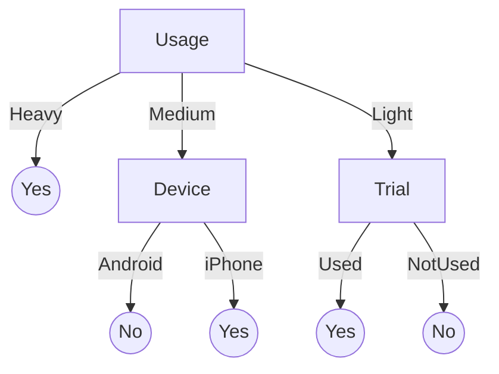

# Topic 7 Worked Example: Solved and Explained

This covers the same 16 question types as the practice exam's written part, in the same order, on a **new table**. Every step explains what the formula means and why it works.

---

## The data

A phone app gives new users a free trial. Can we predict who will **subscribe**?

| User | Device | Usage | Trial | Subscribe |
| --- | --- | --- | --- | --- |
| U1 | Android | Heavy | Used | Yes |
| U2 | iPhone | Light | NotUsed | No |
| U3 | iPhone | Medium | NotUsed | Yes |
| U4 | Android | Medium | Used | No |
| U5 | iPhone | Heavy | NotUsed | Yes |
| U6 | Android | Light | Used | Yes |
| U7 | Android | Light | NotUsed | No |
| U8 | iPhone | Heavy | Used | Yes |
| U9 | Android | Medium | NotUsed | No |
| U10 | iPhone | Light | NotUsed | No |
| U11 | Android | Heavy | NotUsed | Yes |
| U12 | iPhone | Medium | Used | Yes |

Counting the label column first, there are **7 Yes** and **5 No**, so **12 users** in total. You'll use these counts again and again.

---

## Q1. Identify the features and the label

**Answer:** The features are **Device, Usage and Trial**. The label is **Subscribe**.

**How to decide:**
- The **label** (also called the target or class) is the column you want to **predict**. It is the answer the model must give.
- The **features** (also called attributes, predictors or independent variables) are the columns you **already know** about each user and use as clues.

Ask yourself: "Which column is the question, and which columns are the clues?"

---

## Q2. Classification or regression? Binary or multi-class?

**Answer:** It is **classification**, and it is **binary**.

**Why:**
- **Classification vs regression** depends on what kind of value the label holds:
  - a **category** (Yes/No, a species name) means **classification**;
  - a **number** (a price, a temperature) means **regression**.
- **Binary vs multi-class** depends on how many categories the label has:
  - 2 categories means **binary**;
  - 3 or more means **multi-class**;
  - only one class known (normal vs anything strange) means **one-class**.

Subscribe has 2 values, Yes and No, so it is binary.

---

## Q3. Build the confusion matrix

> A model uses the rule: **IF Trial = Used THEN Subscribe = Yes ELSE Subscribe = No.** Take positive = Yes.

### Step 1: apply the rule to every row

For each user, write what the rule **predicts** next to what **actually** happened:

| User | Trial | Predicted | Actual | Box |
| --- | --- | --- | --- | --- |
| U1 | Used | Yes | Yes | TP |
| U2 | NotUsed | No | No | TN |
| U3 | NotUsed | No | Yes | FN |
| U4 | Used | Yes | No | FP |
| U5 | NotUsed | No | Yes | FN |
| U6 | Used | Yes | Yes | TP |
| U7 | NotUsed | No | No | TN |
| U8 | Used | Yes | Yes | TP |
| U9 | NotUsed | No | No | TN |
| U10 | NotUsed | No | No | TN |
| U11 | NotUsed | No | Yes | FN |
| U12 | Used | Yes | Yes | TP |

### Step 2: name each box

Read each name in two halves. The second word is what the model **said**. The first word is whether it was **right**.

- **TP (True Positive):** it said Yes, and that was true. A correct Yes.
- **TN (True Negative):** it said No, and that was true. A correct No.
- **FP (False Positive):** it said Yes, but that was false. This is a **false alarm**.
- **FN (False Negative):** it said No, but that was false. This is a **miss**.

### Step 3: count the boxes and place them

Lecture layout: rows = predicted, columns = actual.

|  | Actual Yes | Actual No |
| --- | --- | --- |
| **Predicted Yes** | TP = 4 | FP = 1 |
| **Predicted No** | FN = 3 | TN = 4 |

**Check:** $4 + 1 + 3 + 4 = 12$ users ✓. The **Actual Yes** column adds up to $4 + 3 = 7$, which matches the 7 Yes in the data ✓.

> [!warning] Orientation trap
> scikit-learn's `confusion_matrix(y_true, y_pred)` prints the **transpose**: rows = actual, columns = predicted. Always check which way round a matrix is before you read FP and FN from it.

---

## Q4. Accuracy and error rate

**Accuracy** is the share of **all** predictions that were correct. Correct predictions are the diagonal boxes, TP and TN:

$$\text{Accuracy} = \frac{TP + TN}{TP + TN + FP + FN} = \frac{4 + 4}{12} = \frac{8}{12} = 0.667$$

**Error rate** is the share that was wrong. Every prediction is either right or wrong, so the error rate is whatever accuracy doesn't cover:

$$\text{Error rate} = 1 - \text{Accuracy} = 1 - 0.667 = 0.333$$

You can also get it directly as $\frac{FP + FN}{\text{total}} = \frac{1 + 3}{12} = 0.333$ ✓.

> [!info] Why accuracy alone isn't enough
> TN is counted in accuracy. When most records are negative, TN is huge, so a lazy model that always says "No" still gets high accuracy while catching nothing. That's why precision and recall leave TN out.

---

## Q5. Precision and recall

Both look only at the **positive class** (Yes). Each one looks at a different slice of the matrix.

### Precision: "When the model says Yes, how often is it right?"

Look only at the **Predicted Yes row**: those are all the times the model said Yes. Some were correct (TP) and some were false alarms (FP).

$$p = \frac{TP}{\underbrace{TP + FP}_{\text{everything predicted Yes}}} = \frac{4}{4 + 1} = \frac{4}{5} = 0.800$$

So when the rule says "this user will subscribe", it's right 80% of the time. FP sits in the denominator because **false alarms are what hurt precision**.

### Recall: "Of the users who really subscribed, how many did the model catch?"

Look only at the **Actual Yes column**: those are all the real subscribers. Some were caught (TP) and some were missed (FN).

$$r = \frac{TP}{\underbrace{TP + FN}_{\text{everything actually Yes}}} = \frac{4}{4 + 3} = \frac{4}{7} = 0.571$$

So the rule found only 57% of the real subscribers. FN sits in the denominator because **misses are what hurt recall**.

> [!tip] Memory trick
> - **P**recision = the **P**redicted row: TP + FP.
> - **R**ecall = the **R**eal (actual) column: TP + FN.

---

## Q6. F1-measure

F1 combines p and r into one number using the **harmonic mean**:

$$F_1 = \frac{2pr}{p + r} = \frac{2(0.800)(0.571)}{0.800 + 0.571} = \frac{0.914}{1.371} = 0.667$$

You can also get it straight from the counts (same answer, less rounding):

$$F_1 = \frac{2\,TP}{2\,TP + FP + FN} = \frac{2(4)}{8 + 1 + 3} = \frac{8}{12} = 0.667$$

**Why the harmonic mean and not the ordinary average?** The ordinary average of 0.8 and 0.571 is 0.686. The harmonic mean is pulled toward the **smaller** value, so a model can't hide a bad recall behind a good precision. F1 is only high when **both** p and r are high.

The extreme case from the slides: with $p = 1$ and $r = 0.01$, the average would be 0.505, but $F_1 \approx 0.02$.

---

## Q7. Precision and recall when **No** is the positive class

Now "positive" means No. **The four boxes swap names**, so rebuild them from the No point of view:

| New name | Meaning now | Old box | Count |
| --- | --- | --- | --- |
| TP′ | said No, really No | TN | 4 |
| FP′ | said No, really Yes | FN | 3 |
| FN′ | said Yes, really No | FP | 1 |

$$p' = \frac{TP'}{TP' + FP'} = \frac{4}{4 + 3} = 0.571 \qquad r' = \frac{TP'}{TP' + FN'} = \frac{4}{4 + 1} = 0.800$$

Precision and recall have **swapped** compared with Q5. The positive class you choose changes the answer, so always check which class the question calls positive.

---

## Q8. Multi-class accuracy

A spam filter sorted 40 messages into 3 classes. Lecture layout: rows = predicted, columns = actual.

| Predicted \ Actual | Work | Personal | Spam | **Row total** |
| --- | --- | --- | --- | --- |
| **Work** | **12** | 2 | 1 | 15 |
| **Personal** | 3 | **10** | 2 | 15 |
| **Spam** | 0 | 1 | **9** | 10 |
| **Column total** | 15 | 13 | 12 | 40 |

With more classes the idea is the same: **correct predictions sit on the diagonal**, where the predicted class equals the actual class.

$$\text{Accuracy} = \frac{\text{diagonal}}{\text{total}} = \frac{12 + 10 + 9}{40} = \frac{31}{40} = 0.775$$

Everything off the diagonal is a mix-up. For example, the 3 in row Personal, column Work means 3 Work messages were wrongly labelled Personal.

---

## Q9. Precision, recall and F1 for one class (Personal)

The multi-class matrix has no single TP, FP and FN. Use **one-vs-rest**: pretend Personal is "positive" and lump Work and Spam together as "negative". Then:

- **TP** = the diagonal cell for Personal = **10**.
- **Precision** looks along Personal's **row**, everything predicted Personal. The row total is $3 + 10 + 2 = 15$:

$$p = \frac{10}{15} = 0.667$$

- **Recall** looks down Personal's **column**, everything that really was Personal. The column total is $2 + 10 + 1 = 13$:

$$r = \frac{10}{13} = 0.769$$

- **F1:**

$$F_1 = \frac{2(0.667)(0.769)}{0.667 + 0.769} = 0.714$$

The same trick works for every class: **row total for precision, column total for recall** (in the lecture layout).

---

## Q10. Holdout: how many records go to testing and training?

The **holdout** method keeps part of the labelled data aside for testing and trains on the rest. The usual split is **one third for testing**.

$$\text{test} = \frac{12}{3} = 4 \qquad \text{train} = 12 - 4 = 8$$

**Stratified sampling** keeps the class ratio (7 Yes : 5 No) in both sets, so the test set would get about 2 Yes and 2 No. Without it, a random 4 could easily be all Yes, and you'd never test the No class.

---

## Q11. k-fold cross-validation: records per fold and models trained

Take **4-fold** cross-validation:

1. Cut the 12 users into $k = 4$ equal folds: $\frac{12}{4} = 3$ users per fold.
2. Train **4 models**. Each model uses a different fold as its test set and trains on the other 3 folds ($9$ users).
3. Every user gets tested **exactly once**, and the test sets **never overlap**. This is the advantage over random subsampling.
4. The final error is the **average** of the 4 test errors.

With the common $k = 10$, each model trains on 90% of the data and tests on 10%.

---

## Q12. Entropy of the label

**Entropy measures how mixed the labels are.**
- If every user said Yes, there is no uncertainty, so **E = 0**.
- If it's 50/50 Yes/No, it's maximally uncertain, so **E = 1** (for 2 classes).

The formula:

$$E(S) = -\sum_{i} p_i \log_2 p_i \qquad \text{where } p_i = \frac{\text{count of class } i}{\text{total in this node}}$$

Read it piece by piece:
- $p_i$ is the fraction of rows in class $i$: here $\frac{7}{12}$ Yes and $\frac{5}{12}$ No.
- $\log_2 p_i$ is negative, because the log of a fraction is negative. The minus sign in front turns the total positive.
- Do this once for each class and add the results.

$$E = -\tfrac{7}{12}\log_2\tfrac{7}{12} - \tfrac{5}{12}\log_2\tfrac{5}{12}$$

$$= 0.454 + 0.526 = 0.980$$

0.980 is close to 1, because 7 vs 5 is almost 50/50.

> [!tip] Calculator
> $\log_2 x = \frac{\ln x}{\ln 2}$. If a class has 0 rows, its term is 0, so skip it.

---

## Q13. Information gain of every column: which one is the root?

**Information gain** answers: **how much does splitting on this column reduce the mixing?**

The recipe is:

1. Take the **entropy of the target** before any split. That's 0.980 from Q12.
2. Split the rows by the column's **values**, for example Usage = Heavy, Medium, Light.
3. For each value, find the **entropy of the target inside that group only**. Call these $E_{\text{Heavy}}$, $E_{\text{Medium}}$ and $E_{\text{Light}}$.
4. **Weight** each one by how many rows are in that group out of the total ($\frac{4}{12}$, and so on), then add them up. This weighted sum is $\text{info}_A(D)$, the mixing that is **left** after the split.
5. **Gain = entropy before − weighted entropy after.**

$$\text{gain}(A) = \underbrace{E(\text{target})}_{\text{before}} - \underbrace{\sum_{v} \frac{|D_v|}{|D|}\,E(D_v)}_{\text{after: weighted by group size}}$$

The weighting is needed because a big group matters more than a tiny one. A pure group of 1 row shouldn't count as much as a mixed group of 7.

### Usage

| Value | Users | Yes / No | Entropy inside the group |
| --- | --- | --- | --- |
| Heavy | U1, U5, U8, U11 | 4 / 0 | $0$ (pure) |
| Medium | U3, U4, U9, U12 | 2 / 2 | $1$ (50/50) |
| Light | U2, U6, U7, U10 | 1 / 3 | $-\frac{1}{4}\log_2\frac{1}{4} - \frac{3}{4}\log_2\frac{3}{4} = 0.811$ |

$$\text{info}_{\text{Usage}} = \tfrac{4}{12}(0) + \tfrac{4}{12}(1) + \tfrac{4}{12}(0.811) = 0 + 0.333 + 0.270 = 0.604$$

$$\text{gain(Usage)} = 0.980 - 0.604 = \mathbf{0.376}$$

### Device

| Value | Yes / No | Entropy |
| --- | --- | --- |
| Android (6) | 3 / 3 | $1$ |
| iPhone (6) | 4 / 2 | $0.918$ |

$$\text{info}_{\text{Device}} = \tfrac{6}{12}(1) + \tfrac{6}{12}(0.918) = 0.959 \qquad \text{gain} = 0.980 - 0.959 = 0.021$$

### Trial

| Value | Yes / No | Entropy |
| --- | --- | --- |
| Used (5) | 4 / 1 | $0.722$ |
| NotUsed (7) | 3 / 4 | $0.985$ |

$$\text{info}_{\text{Trial}} = \tfrac{5}{12}(0.722) + \tfrac{7}{12}(0.985) = 0.876 \qquad \text{gain} = 0.980 - 0.876 = 0.104$$

### Pick the root

| Column | Gain |
| --- | --- |
| **Usage** | **0.376** ← highest |
| Trial | 0.104 |
| Device | 0.021 |

**Root = Usage.** Splitting on it removes the most uncertainty. Device barely helps (0.021), because both of its groups stay almost as mixed as before.

---

## Q14. Repeat inside each branch

After the root split, **each branch is its own small problem**. The "universe" is now **only the rows in that branch**, so the weights use the branch size (4 here), **not 12**.

### Usage = Heavy (U1, U5, U8, U11): 4 Yes / 0 No

The entropy is 0: it's pure, so **stop**. This is a **leaf: Yes**. No calculation needed.

### Usage = Medium (U3, U4, U9, U12): 2 Yes / 2 No, $E = 1$

The remaining columns are Device and Trial.

| Column | Groups inside Medium | Weighted entropy | Gain |
| --- | --- | --- | --- |
| Device | Android: U4, U9 → 0 / 2 ($E = 0$) iPhone: U3, U12 → 2 / 0 ($E = 0$) | $\tfrac{2}{4}(0) + \tfrac{2}{4}(0) = 0$ | $1 - 0 = \mathbf{1.000}$ |
| Trial | Used: U4, U12 → 1 / 1 ($E = 1$) NotUsed: U3, U9 → 1 / 1 ($E = 1$) | $\tfrac{2}{4}(1) + \tfrac{2}{4}(1) = 1$ | $1 - 1 = 0$ |

**Split on Device.** Both of its groups are pure: Android → **No**, iPhone → **Yes**. Trial's gain is 0: splitting on it leaves the groups exactly as mixed as before.

### Usage = Light (U2, U6, U7, U10): 1 Yes / 3 No, $E = 0.811$

| Column | Groups inside Light | Weighted entropy | Gain |
| --- | --- | --- | --- |
| Trial | Used: U6 → 1 / 0 ($E = 0$) NotUsed: U2, U7, U10 → 0 / 3 ($E = 0$) | $0$ | $0.811 - 0 = \mathbf{0.811}$ |
| Device | Android: U6, U7 → 1 / 1 ($E = 1$) iPhone: U2, U10 → 0 / 2 ($E = 0$) | $\tfrac{2}{4}(1) + \tfrac{2}{4}(0) = 0.5$ | $0.811 - 0.5 = 0.311$ |

**Split on Trial.** Both of its groups are pure: Used → **Yes**, NotUsed → **No**.

> [!info] When to stop
> - A node is **pure** (entropy 0) → it becomes a leaf with that class.
> - There are **no attributes left**, or **no rows left** → stop, and use the **majority** class.
>
> Not every leaf has to be pure. Here they all happen to be.

---

## Q15. Draw the final tree

How to draw it: the **root** is the column with the highest gain. Each **branch** is one of its values. Under each branch goes either a **leaf** (if the node is pure) or the **next best column** for that branch.

---

## Q16. Classify a new user

**New user A = (Android, Medium, Used).** Start at the root and follow the branches:

1. Usage = **Medium** → go to the Device node.
2. Device = **Android** → **No**.

**Prediction: does not subscribe.** Trial = Used is never checked, because the Medium branch doesn't test Trial.

**New user B = (iPhone, Light, Used):**

1. Usage = **Light** → go to the Trial node.
2. Trial = **Used** → **Yes**.

**Prediction: subscribes.**

---

## Common mistakes

1. **Reading the matrix the wrong way round.** The lecture has rows = predicted; scikit-learn has rows = actual.
2. **Mixing up FP and FN.** The second word is what the model said, and the first word is whether it was right.
3. **Precision with the wrong denominator.** Precision uses the predicted row (TP + FP). Recall uses the actual column (TP + FN).
4. **Forgetting the weights in info gain.** Multiply each group's entropy by (group size / node size) before adding.
5. **Using the full total inside a branch.** Inside Medium, the weights are out of 4, not 12.
6. **Comparing the raw group entropies instead of the gains.** Weight them, subtract from the target entropy, and then pick the **highest gain**.
7. **Labels are names, not numbers.** Yes/No recoded as 1/0 is still classification.

---

## Formula sheet in plain words

| Formula | In words |
| --- | --- |
| $\text{Accuracy} = \frac{TP + TN}{\text{total}}$ | Share of all predictions that were right. |
| $\text{Error} = 1 - \text{Accuracy}$ | Share that was wrong. |
| $p = \frac{TP}{TP + FP}$ | When it says Yes, how often it's right. Uses the predicted row. |
| $r = \frac{TP}{TP + FN}$ | Of the real Yes, how many it caught. Uses the actual column. |
| $F_1 = \frac{2pr}{p + r}$ | One score that is high only if both p and r are high. |
| $p_k = \frac{N_{kk}}{\text{row } k}$, $r_k = \frac{N_{kk}}{\text{col } k}$ | Multi-class, one-vs-rest. |
| $E = -\sum p_i \log_2 p_i$ | How mixed the labels are: 0 = pure, 1 = 50/50. |
| $\text{info}_A(D) = \sum \frac{\lvert D_v \rvert}{\lvert D \rvert} E(D_v)$ | Mixing left after the split, with each group weighted by its size. |
| $\text{gain}(A) = E(D) - \text{info}_A(D)$ | How much the split reduced the mixing. Pick the highest. |
